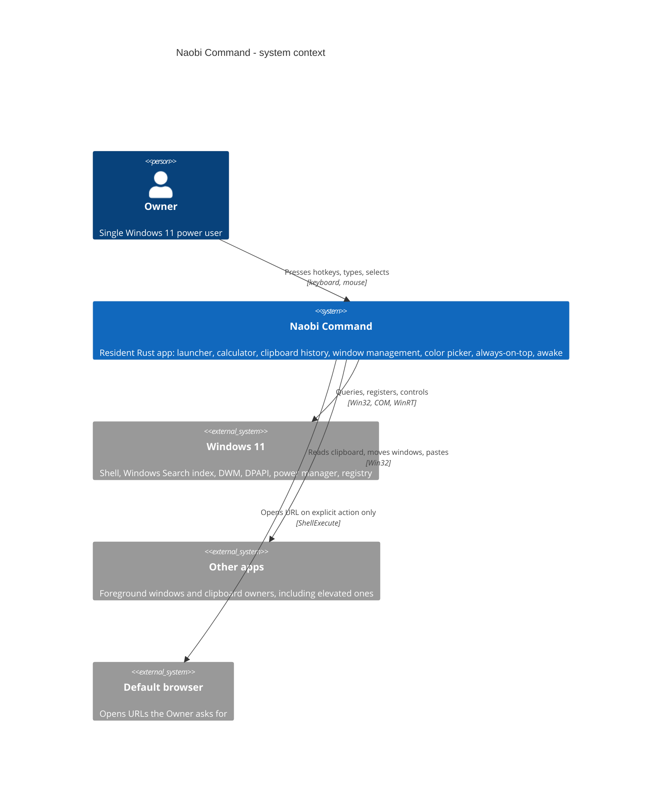
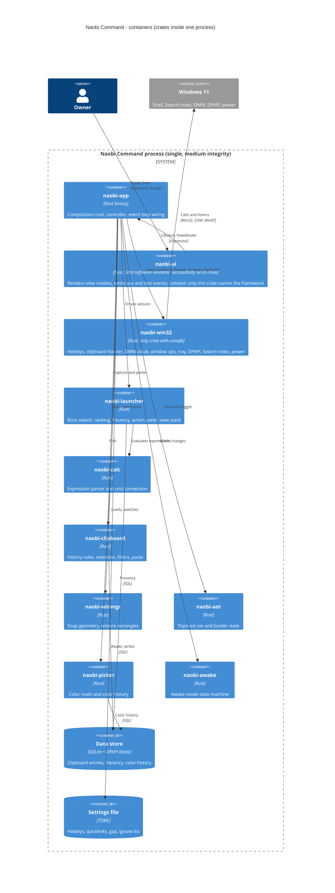
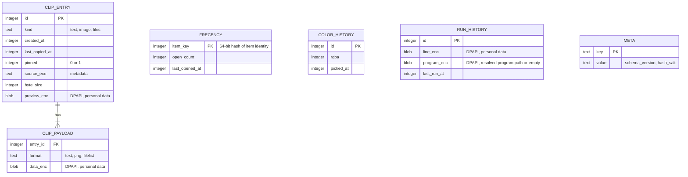
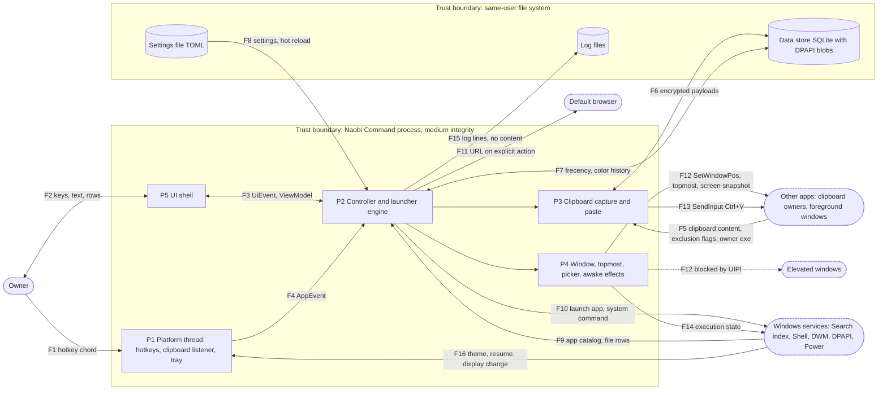
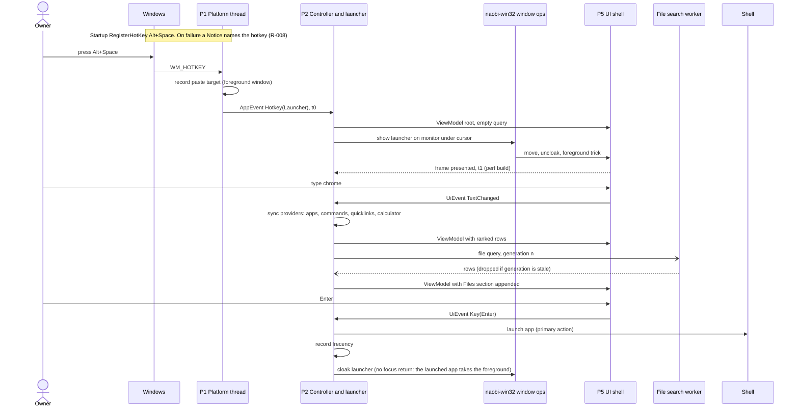
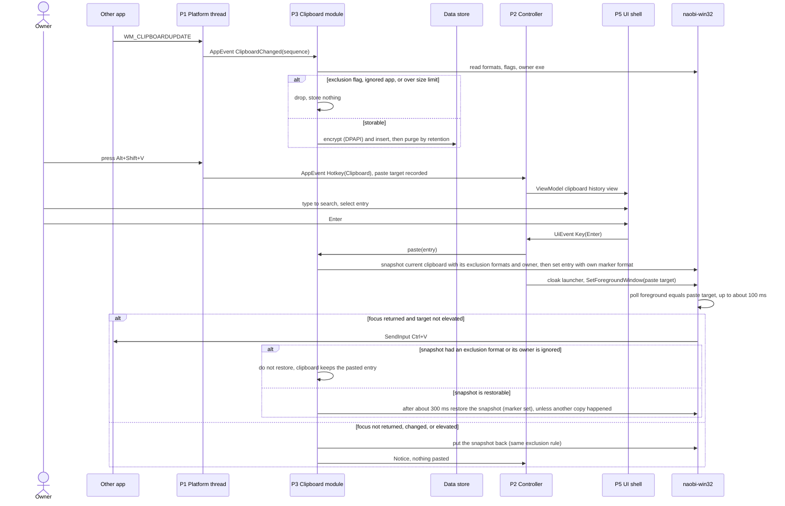
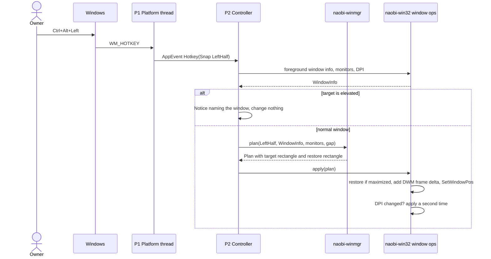
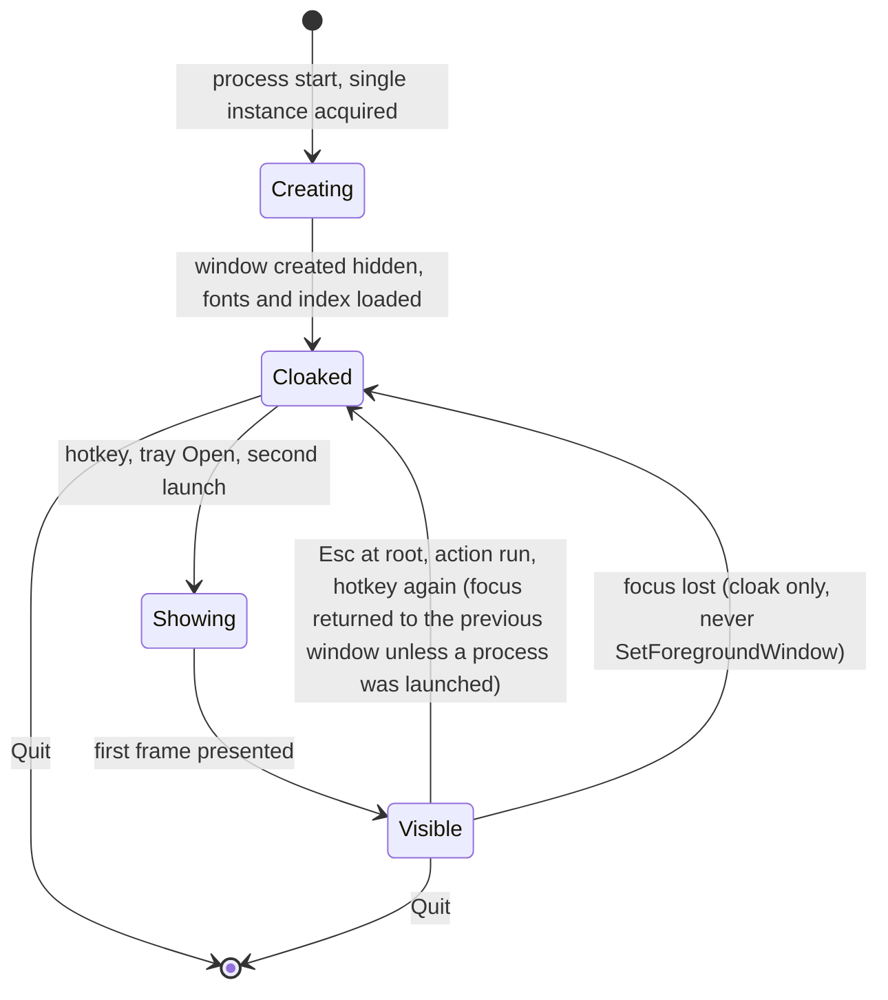
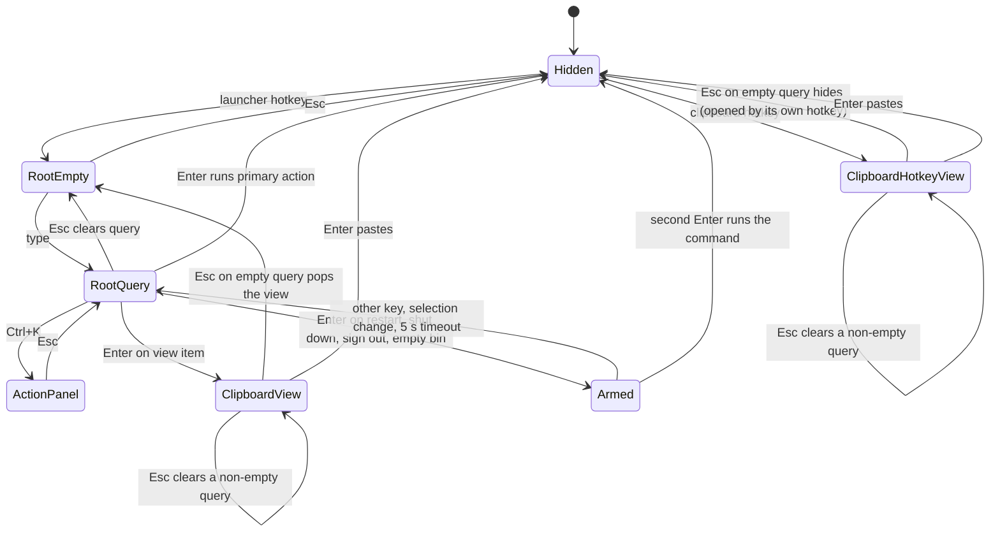
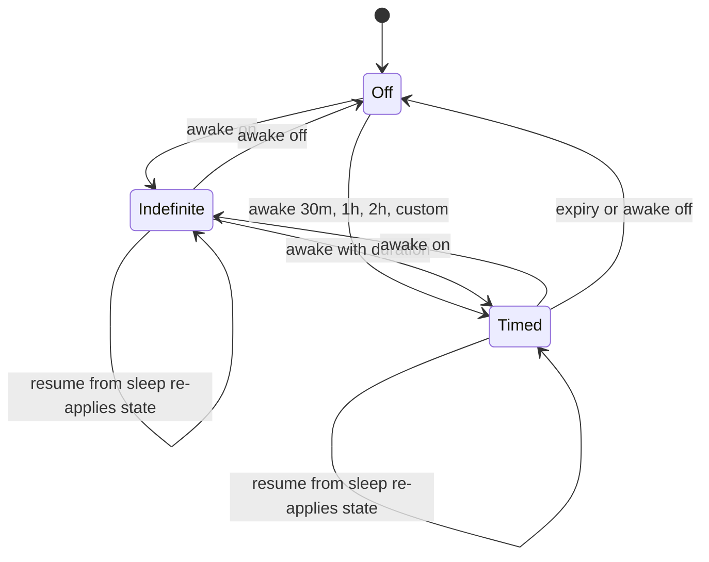

# Design Report: Naobi Command

<!-- English only. Every chapter stays; an irrelevant chapter says "N/A — <reason>". Source of truth: docs/ledger.yaml. Generated pieces (requirement lists, diagram embeds, STRIDE counts, Appendix A) are produced from the ledger and docs/diagrams by a script; edit the sources, not the copies. -->

Status: draft for Gate 1 · Plane: NCMD-2 · Date: 2026-10-22 · Ledger: 60 entries (R-001..R-023, D-001..D-037)

## 0. Executive summary

Naobi Command is a personal tool for one Windows 11 power user (the Owner). It replaces Raycast and PowerToys with one resident Rust process that has seven modules: launcher (apps, files, system commands, quicklinks), inline calculator with unit conversion, clipboard history, window management, color picker, always-on-top and awake. It runs at medium integrity, makes no network connection except when the Owner opens a URL, and keeps all data local.

The stack is Rust with a native, non-webview UI (ADR-0001). The budgets that justify it are in R-006: hotkey-to-visible p95 <= 50 ms, idle working set <= 40 MB, exe <= 20 MB. The installed Raycast measures about 991 MB working set in total and Command Palette 137 MB.

The UI framework is Slint with the software renderer and the accessibility feature enabled (D-034, resolving D-002). GPUI, femtovg and skia were rejected on measured evidence (ADR-0002, `docs/research/ui-prototype.md`). The UI is still isolated (ADR-0002, D-010): everything else is written against a view model and a UI event type, and `naobi-app` calls `naobi-ui` directly.

Main risks: keystroke-to-results p95 <= 16 ms is not yet proven with the software renderer (the spike's screen probe gave an upper bound of 26.7 ms, with about 7 ms of probe overhead), so the first Build slice measures it before other modules are built (RK-15); hotkey-to-visible latency has never been published for either reference product. Measured on the spike, untrimmed, the software renderer idles at 24 MB working set (27.3 MB with accessibility), about 8 MB private bytes and 0.00% CPU, so the 40 MB budget has headroom. The Owner has answered the open decisions of review round 1 (section 11.5). The other autonomous defaults (D-010 to D-030, except those answered) still await confirmation.

Gate 1 asks the Owner to approve this report, the diagrams and the design system, to confirm the remaining autonomous defaults in chapter 11, and to note that the ledger gate is clean now that D-002 is resolved (D-034). The mockup direction is already approved (D-031).

## 1. Product

**Problem (R-001).** The Owner runs two separate, memory-heavy tools, Raycast and PowerToys, whose features do not fit their needs. A tailored replacement removes both.

**Persona.** One person: the Owner, a Windows 11 x86_64 power user who works keyboard-first, uses Proton Pass, and has a PC with S3 sleep (R-019). No accounts, no multi-user features, no public distribution.

**Goals and success (R-002).** The Owner uses the app daily for 14 days with PowerToys uninstalled and Raycast not installed, with zero fallbacks to either for an MVP capability, and every R-006 budget reports PASS in the perf harness.

**Scope (R-003, R-004, R-005).** Seven MVP modules on Windows 11 x86_64 only. Phase 2: snippets, OCR text extractor, keyboard remapper, the remaining PowerToys utilities, drag-to-zone overlays, an own NTFS file index, currency conversion, a settings window, a UIAccess build. Out of scope: Raycast extension compatibility, any plugin system, AI features.

**Constraints (D-008).** Budget Rp0 (free and open-source dependencies only), no hard deadline, the Owner is the single decider. Clean-room rule (D-004): behaviour notes only from `docs/research/`, no third-party code or assets in the product.

## 2. Requirements

### 2.1 Functional requirements

Copied from `docs/ledger.yaml`; `(critical)` marks the critical user flows of D-006.

#### Product and scope

**R-001** (v1): Naobi Command is a personal tool for one Windows 11 power user (the owner) that replaces two separate, memory-heavy tools (Raycast and PowerToys) with one tailored app; it is not distributed publicly.

- The app runs for a single local user with no account and no multi-user features

**R-002** (v1): Success means the owner uses Naobi Command daily for 14 days with PowerToys uninstalled and Raycast not installed, without falling back to either for any MVP capability, and every performance budget in R-006 passes.

- A 14-day usage log records zero fallbacks to PowerToys or Raycast for MVP capabilities
- perf-harness reports every R-006 budget as PASS

**R-003** (v1): The only supported platform is Windows 11 on x86_64; macOS and Linux are out of scope.

- The release build targets x86_64-pc-windows-msvc only

**R-004** (v1): The MVP contains seven modules: launcher (apps, files, system commands, web-search quicklinks), inline calculator with unit conversion, clipboard history, window management (snap to zones), color picker, always-on-top, and awake. Snippets, OCR text extractor, keyboard remapper and the remaining PowerToys utilities are phase 2.

- Each of the seven MVP modules is reachable from the launcher or its own hotkey
- No phase-2 module ships in the MVP build

**R-005** (v1): Out of scope for the MVP: Raycast extension compatibility, any third-party plugin system, and AI features; all modules are built into the Rust binary.

- The MVP build loads no external plugin code and makes no AI calls

#### Launcher and platform

**R-008** (v1): As the owner, I press Alt+Space anywhere to open the launcher so that every capability starts from one hotkey; if the hotkey is already registered, the app reports the conflict instead of failing silently.

- Alt+Space opens the launcher from any foreground app
- When Alt+Space is taken by another process, a visible conflict notice names the hotkey

**R-012** (v2): (critical) As the owner, I type into one root search that mixes apps, files, commands, quicklinks and calculator results, ranked exact alias first, then fuzzy title match with a frecency boost of at most 20% of the fuzzy score, with file results in a trailing section because Windows Search results arrive last; Enter runs the primary action, Ctrl+Enter the secondary action, Ctrl+K opens the action panel, and Esc clears the query, then pops the view, then hides the launcher; a view opened directly by its own hotkey (for example clipboard history via Alt+Shift+V) hides on Esc instead of popping to the root view.

- Typing an exact alias ranks its item first
- An item opened more often ranks above an equal fuzzy match; frecency never raises an item by more than 20% of its fuzzy score
- Enter on an app result launches it and hides the launcher
- Ctrl+K lists the selected result's actions
- Esc with a non-empty query clears it; Esc on an empty root view hides the launcher
- Esc on an empty query in a view opened by its own hotkey hides the launcher
- File results appear after the other results

**R-013** (v1): File results in the MVP come from querying the Windows Search system index; the app keeps no file index of its own. An own NTFS index is phase 2.

- A file in an indexed location appears in results by name
- When Windows Search is disabled, the launcher shows a 'file search unavailable' row instead of an error

**R-014** (v1): Typing an expression in the root search shows an inline calculator result supporting arithmetic, percentages, powers and hex/binary, plus unit conversion in eight categories (length, mass, temperature, volume, data size, time, speed, area); there is no currency conversion; Enter copies the result.

- Expressions such as 2^10 + 15% evaluate correctly in unit tests
- 5 km to mi and 100 F to C convert correctly
- Enter on a calculator result puts the result text on the clipboard

**R-020** (v1): System commands are lock, sleep, hibernate, restart, shut down, sign out, empty recycle bin, toggle dark mode and open Windows settings; restart, shut down, sign out and empty recycle bin require a second Enter to confirm.

- A single Enter on Restart only arms the confirmation; a second Enter executes
- Toggle dark mode flips the Windows app theme

**R-021** (v1): Quicklinks are defined in the settings TOML as URL templates with a {query} placeholder and an alias; the defaults are Google, GitHub, YouTube and naobi.dev; typing '<alias> <text>' opens the URL with the text URL-encoded in the default browser.

- Typing gh react native opens the GitHub search URL with react%20native

**R-022** (v1): The app shows only a tray icon (no taskbar button) with the menu Open, Pause hotkeys, Awake status, Settings and Quit.

- The launcher window never appears in the taskbar or Alt+Tab
- Pause hotkeys stops every global hotkey until resumed

**R-023** (v1): Only one instance runs; a second launch shows the first instance's launcher and exits. The launcher window is created hidden at startup and hidden by DWM cloaking, never destroyed, so showing it does not create a window.

- Starting the exe twice leaves one process and shows the launcher
- The launcher HWND is identical across 100 show/hide cycles

**R-024** (v1): Typing '>' and a command line in the Launcher root search shows a run row; Enter runs the line in a new PowerShell 7 (pwsh) console window that stays open, or in Windows PowerShell 5.1 when pwsh is not found, or starts the program directly without a console when the first token resolves through PATH or App Paths to a GUI-subsystem exe; '>' alone lists the run history newest first and '>text' lists the run history command lines that contain text below the run row; the run history keeps at most 100 command lines for at most 30 days, each stored as a DPAPI current-user blob and never logged; there is no run-as-administrator action and no second Enter.

- Enter on '>' followed by a command line opens a new PowerShell console window that runs exactly that line and stays open after it ends, and the Launcher hides
- pwsh.exe runs the line when it resolves, otherwise powershell.exe; when neither resolves a Run Notice says PowerShell could not be started
- A line whose first token resolves through PATH or App Paths to a GUI-subsystem exe starts that exe with the rest of the line as its arguments and no console; any other line, and any lookup that fails, runs in the console
- Quotes, $, %, |, & and > in the line reach PowerShell unchanged
- '>' alone lists the run history newest first; '>text' lists the run row and then the run history command lines that contain text; no other Item is listed and no file search starts
- Enter on a run history command line runs it again and moves it to the top without adding a duplicate; Delete in the action panel removes it from the run history
- The run history keeps at most 100 command lines and none older than 30 days
- No command line appears in plaintext in naobi.db, naobi.db-wal or the logs
- Run rows are never counted in frecency, and their item ids and icon keys contain no command text
- The first Enter runs the command line (no arming) and no run-as-administrator action is offered

#### Clipboard history

**R-009** (v1): All data stays local: settings as TOML in %APPDATA%\NaobiCommand, clipboard history in SQLite with entry contents encrypted by Windows DPAPI (current user), retained for at most 30 days or 1,000 entries; clipboard updates flagged with ExcludeClipboardContentFromMonitorProcessing or CanIncludeInClipboardHistory=0 are never stored; a 'Clear clipboard history' command deletes all entries. UU 27/2022 does not apply because the owner processes only their own data on their own device.

- Clipboard entry contents in the SQLite file are not readable as plaintext
- Entries older than 30 days or beyond 1,000 are purged
- A copy flagged with ExcludeClipboardContentFromMonitorProcessing is not stored
- Clear clipboard history leaves zero entries

**R-015** (v2): (critical) As the owner, I press Alt+Shift+V to open clipboard history holding text, images up to 10 MB and file lists; I can search text, pin entries, press Enter to paste into the previously focused app or Ctrl+Enter to copy only; copies from apps on the ignore list (default the Proton Pass desktop app, planned exe name 'Proton Pass.exe', confirmed at build) are never stored.

- Copy text, open history, Enter: the text is pasted into the previous app
- An image larger than 10 MB is not stored
- A pinned entry survives retention purge
- A copy made while 'Proton Pass.exe' owns the clipboard is not stored

#### Window management and always-on-top

**R-011** (v1): The app never runs elevated in the MVP; when a module targets an elevated window it cannot control (UIPI), it shows a notice naming the window instead of failing silently. A UIAccess build is reconsidered in phase 2.

- Snapping or pinning an elevated window shows the admin-window notice and changes nothing

**R-016** (v1): (critical) Window management offers keyboard commands for halves, thirds, quarters, center, maximize, almost-maximize, move to next display and restore, with a configurable gap; default hotkeys are Ctrl+Alt+Arrow for halves, Ctrl+Alt+Enter maximize, Ctrl+Alt+C center and Ctrl+Alt+Backspace restore. Drag-to-zone overlays are phase 2.

- Ctrl+Alt+Left places the foreground window on the left half of its monitor work area, gap applied
- Restore returns the window to its pre-command rectangle
- Next display moves the window keeping its relative position, correct on mixed-DPI monitors

**R-018** (v2): Win+Ctrl+T toggles always-on-top for the foreground window; a pinned window gets a 2 px border that can be disabled in settings and is the Naobi oxide accent #914A3B when Windows is in light mode and stone-focus #E3BDA9 when Windows is in dark mode (each at least 3:1 against its theme window color); no sound is played.

- Toggling twice returns the window to non-topmost
- The border follows the pinned window when it moves and disappears when unpinned
- The border color is #914A3B in Windows light mode and #E3BDA9 in Windows dark mode and changes with the theme without restart

#### Color picker

**R-017** (v1): Win+Shift+C starts the color picker with a magnifier; a click copies the color as HEX; HEX, RGB, HSL and OKLCH formats are available from the launcher; the last 20 picked colors are kept.

- Picking a known pixel copies its exact HEX value
- The 21st pick drops the oldest color

#### Awake

**R-019** (v1): Awake keeps the PC from sleeping in Indefinite or Timed mode (30 min, 1 h, 2 h or a custom duration), optionally keeping the display on; it is controlled by launcher commands such as 'awake 1h' and its state shows in the tray icon. The owner's PC uses S3 sleep (no Modern Standby).

- During Timed mode, powercfg /requests lists the app; after expiry it does not
- The tray icon reflects Off, Indefinite or Timed


### 2.2 Non-functional requirements

**R-006** (v4): Performance budgets: hotkey-to-visible p95 <= 50 ms; keystroke-to-results p95 <= 16 ms over a 10,000-item index, from the key event received by the window procedure to the presentation of the frame that contains the new results; idle working set <= 40 MB total, measured without working-set trimming; idle CPU < 0.5% averaged over 60 s; process start to tray-ready (tray icon shown, hotkeys registered) <= 300 ms, pre-warmed launcher window ready <= 1.5 s after process start, and a hotkey pressed before the window is ready is served as soon as it is; release exe <= 20 MB. The installed PowerToys is measured as the baseline.

- perf-harness measures hotkey-to-visible p95 <= 50 ms over 200 runs
- perf-harness measures keystroke-to-results p95_est <= 25 ms (p95_upper minus the measured probe cost, R-006 v5) over a 10,000-item index, from the key event received by the window procedure to the presentation of the frame that contains the new results
- Idle working set <= 40 MB and idle CPU < 0.5% over 60 s, measured without working-set trimming
- Process start to tray-ready <= 300 ms and launcher window ready <= 1.5 s after process start; a hotkey pressed before the window is ready opens the launcher as soon as it is ready; release exe size <= 20 MB
- A baseline report records the same metrics for the installed PowerToys

**R-007** (v1): The UI applies the Naobi design tokens from naobi.dev DESIGN.md with a light 'paper' theme and a dark 'stone' theme that follow the Windows app theme, embeds Inter and JetBrains Mono, uses English copy, meets WCAG 2.2 AA contrast, and every capability is operable by keyboard alone.

- Switching Windows between light and dark mode switches the app theme without restart
- All text/background token pairs meet WCAG 2.2 AA contrast ratios
- Every MVP capability can be completed without a mouse

**R-010** (v2): The app has no accounts, runs at medium integrity as the signed-in user, makes no outbound network connection except when the owner explicitly opens a URL (a program the owner starts with a '>' command line is the owner's own process, not the app's), and any phase-2 module needing admin rights runs in a separate helper elevated on demand. Security bar: OWASP ASVS 5.0 Level 1 where applicable, plus a STRIDE threat model.

- The main process token is not elevated
- No socket is opened by the app or its own child processes during a 10-minute idle-and-use session without an explicit URL action; the session runs no '>' command line
- STRIDE threats in the design report each have a mitigation, test or accepted risk


| Area | Requirement | Source |
|---|---|---|
| Performance | Budgets as in R-006, measured by `naobi-perf` (chapter 9) | R-006 |
| Security | OWASP ASVS 5.0 Level 1 for the relevant chapters plus the STRIDE model in chapter 6 | R-010 |
| Accessibility | WCAG 2.2 AA contrast, keyboard-only operation. Screen-reader support (UI Automation) is a weighted criterion, not a hard requirement (D-032), and is on with the software renderer (D-034, section 11.5) | R-007 |
| Availability | Not applicable as a service. The process restarts at login through the HKCU Run value (D-007); a crash loses only in-memory state (D-014) | D-007 |
| Scale and data volume | 10,000 launcher items; at most 1,000 clipboard entries plus 100 pinned; store capped at 500 MB; 20 colors | R-006, D-015 |
| Platform | Windows 11 x86_64, target `x86_64-pc-windows-msvc` only (R-003); minimum build assumed 22H2 (build 22621) | R-003, assumption |

### 2.3 Assumptions the ledger does not settle

This design run was autonomous, so each assumption is a `D-` entry with `answer: "autonomous default"` for confirmation at Gate 1. A correction changes only the named entry.

| Topic | Assumption | Ledger |
|---|---|---|
| Platform | Windows 11 22H2 or later; per-monitor-v2 DPI aware process; elevated apps cannot be controlled (R-011) | R-003, R-011 |
| Auth and hosting | None. No server, no accounts, no hosting | R-001, D-007 |
| Data stores | One SQLite file in `%LOCALAPPDATA%`, DPAPI per blob; settings TOML in `%APPDATA%`; frecency stores a salted xxh3 hash, not paths | D-014 |
| Clipboard limits | Text 1 MiB, PNG 10 MB, store 500 MB, 100 pinned, rate limit 10/s | D-015 |
| Ranking | Exact alias, then fuzzy plus a frecency boost of at most 20% of the fuzzy score; files in a trailing async section (owner-confirmed, R-012 v2) | D-016 |
| Calculator | f64, percent semantics, display rounding, decimal KB and binary KiB, i128 for hex and bin | D-017 |
| Notices | Sticky: balloon plus a banner on the next Launcher show and a tray tooltip | D-018 |
| Paste | Clipboard write, cloak, return focus to the paste target, verify, SendInput Ctrl+V, then restore the previous clipboard after about 300 ms (owner-chosen, D-019 v5; text, image and file list only, other formats come back degraded); abort otherwise | D-019 |
| Logging | Local rolling files, no content | D-020 |
| Launcher geometry | 750 x 475, top at 20% of the work area, hide on focus loss, always start at root | D-021 |
| Window defaults | Gap 8 px, almost-maximize 90%, third and quarter set, restore in memory | D-022 |
| Color picker | Frozen snapshot overlay, formats as actions on history items | D-023 |
| Command catalog | Names, awake grammar, default quicklink aliases, no run-as-admin | D-024 |
| Tests | Three tiers; tier 2 is `#[ignore]`d and run before Gate 3; no hosted CI before Ship | D-025 |
| Design tokens | Desktop adaptation of the Naobi tokens, one contrast fix | D-030 |
| Mockups | Direction approved by the Owner; remaining screens specified per ticket | D-031 |
| Screen reader | Weighted criterion, enabled when it costs < 5 MB working set | D-032 |
| Security level | ASVS Level 1 confirmed | D-033 |

## 3. Architecture

Terms: a *seam* is the place where a module's interface lives and behaviour can change without editing in place; an *adapter* is a concrete thing that satisfies an interface at a seam; a *port* is a Rust trait at a seam. "Module" in the product sense (the seven capabilities) is defined in `GLOSSARY.md`; in this chapter "deep module" is used in the design sense: much behaviour behind a small interface.

### 3.1 Context

<!-- source: docs/diagrams/c4-context.mmd -->


### 3.2 Containers

The product is one process. A "container" below is a crate with a single responsibility; D-005 fixes one crate per module.

<!-- source: docs/diagrams/c4-container.mmd -->


### 3.3 Crate map

| Crate | Responsibility | Depends on | Unsafe |
|---|---|---|---|
| `naobi-core` | Shared kernel: ids, `Item`, `Action`, `Effect`, `Notice`, `AppEvent`, `Settings` model and parser, `CommandSource` trait, the UI data types (`ui::ViewModel`, `UiEvent`, tokens) (no framework types), `Db` handle and migrations | std, serde, toml, rusqlite, thiserror | no |
| `naobi-calc` | Expression parser, percent semantics, unit tables, base output | core | no |
| `naobi-launcher` | Root search: providers, ranking, frecency, action panel, view stack, Esc ladder, armed commands, quicklinks, system and module command catalog | core, calc | no |
| `naobi-clipboard` | Capture rules, filters, retention, store, in-memory text index, paste | core | no |
| `naobi-winmgr` | Snap geometry (pure), restore rectangles, elevation check use | core | no |
| `naobi-aot` | Topmost set, border state, border geometry | core | no |
| `naobi-picker` | Color math (HEX, RGB, HSL, OKLCH), history | core | no |
| `naobi-awake` | Mode state machine, expiry, re-apply on resume | core | no |
| `naobi-ui` | Slint adapter (software renderer, accessibility on): draws `ViewModel`, emits `UiEvent`, exposes a `Clone + Send` handle to post view models and show or hide | core | no (the framework crate may) |
| `naobi-win32` | Adapters for every Win32, COM and WinRT port: hotkeys, hidden tool window, clipboard listener, DWM cloak, window ops, tray, balloon, DPAPI, Search index, AppsFolder, shell execute, registry, GDI snapshot, overlays, power | core and module crates (to implement their ports) | yes (ADR-0003) |
| `naobi-app` | Composition root and controller: starts threads, wires ports, calls `naobi-ui` directly | all | no |
| `naobi-perf` | Perf harness binary for R-006 and the PowerToys baseline | app internals via a `perf` feature | no |

### 3.4 Seams (the TDD seams of Build)

Dependency categories: in-process; local-substitutable (has a local stand-in); remote but owned; true external. There is no remote dependency of any kind (R-010), so only three of the four categories occur.

| Seam | Interface a test crosses | Category | Adapters |
|---|---|---|---|
| Calculator | `naobi_calc::evaluate(&str) -> Option<CalcOutcome>` | in-process | none |
| Settings | `Settings::parse(&str) -> Result<Settings, ParseReport>`; `Settings::apply(prev, text)` keeps the last valid value | in-process | none |
| Launcher engine | `Launcher::query(text, generation) -> ResultSet`; `Launcher::handle(UiEvent) -> Vec<Effect>`; ports `AppCatalog`, `FileSearch`, `Clock` | in-process core; ports true external | prod: AppsFolder, Windows Search; test: in-memory fakes |
| Frecency store | `FrecencyStore::{record, boost}` | local-substitutable | prod: SQLite file; test: SQLite `:memory:` |
| Clipboard history | `History::{on_change, list, search, paste, clear}`; ports `ClipSource`, `OwnerResolver`, `Cipher`, `Pasteboard` | store local-substitutable; ports true external | `Cipher`: DPAPI (prod) and a tagged identity cipher (test), so a real seam; others fakes |
| Window plan | `naobi_winmgr::plan(cmd, &WindowInfo, &[Monitor], gap) -> Plan` (pure); port `WindowOps` | in-process; port true external | prod: Win32; test: fake with synthetic monitors (mixed DPI) |
| Topmost | `Topmost::toggle(WindowId)`; port `TopmostOps` | port true external | prod: Win32; test: fake |
| Color picker | `format(Rgba, Format) -> String`; `ColorHistory::{push, list}`; port `ScreenCapture` | in-process; history local-substitutable | prod: GDI; test: synthetic bitmap |
| Awake | `Awake::{set(Mode), on_resume, remaining}`; ports `PowerPort`, `Clock` | in-process; ports true external | prod: `PowerCreateRequest`/`PowerSetRequest`; test: recording fake with a fake clock |
| UI isolation | `ViewModel` and `UiEvent` data types; `Launcher::handle(UiEvent) -> Vec<Effect>` is what tests cross. No `UiShell` trait: D-034 fixed the framework, so there is one adapter | in-process data; the framework is true external | Slint (software renderer). Tests assert on `Effect` and `ViewModel` values, so no headless shell is needed |
| OS boundary | `naobi-win32` public functions | true external | contract tests (tier 2) on a real desktop |

The launcher is a functional core: `handle(UiEvent)` returns `Effect` values (`Launch`, `Hide`, `CopyText`, `Notice`, `PushView`, `Paste`) and the controller in `naobi-app` executes them. A test therefore asserts effects, not Win32 calls.

Interface sketches (Rust, indicative; Build refines):

```rust
// naobi-core::ui  (ADR-0002): plain data with no framework types
pub struct ViewModel { pub theme: Theme, pub view: View, pub action_panel: Option<ActionPanelView>,
                       pub notice: Option<Notice>, pub loading: bool }
pub enum UiEvent { TextChanged(String), Key(KeyChord), RowActivated(RowId), Dismissed }
// naobi-ui (Slint, software renderer, accessibility on); naobi-app calls it directly
pub fn run(on_event: impl Fn(UiEvent) + Send + 'static) -> ExitCode;   // owns the main-thread loop
#[derive(Clone)] pub struct UiHandle { /* Slint weak handle */ }
impl UiHandle {
    pub fn post(&self, vm: ViewModel);             // coalesced, latest wins
    pub fn show(&self, at: Placement);            // move + size; uncloak is done by naobi-win32
    pub fn hide(&self);
    pub fn window(&self) -> RawWindowHandle;      // safe handle value
}
// naobi-core
pub trait CommandSource: Send + Sync {        // built-in only (R-005); no dynamic loading
    fn items(&self, q: &Query) -> Vec<Item>;
    fn run(&self, id: &ItemId, action: ActionId, cx: &mut Cx) -> Outcome;
}
```

### 3.5 Threads and concurrency

No async runtime: std threads and channels (ADR-0001).

| Thread | Owns | Notes |
|---|---|---|
| UI thread | The framework event loop and the Launcher window | Draws view models, emits `UiEvent`. Idle when hidden |
| Platform thread (P1) | Hidden top-level tool window (`WS_EX_TOOLWINDOW`, never shown; a message-only window does not receive the broadcast messages): `WM_HOTKEY`, `WM_CLIPBOARDUPDATE`, `WM_SETTINGCHANGE` (theme), `WM_POWERBROADCAST`, `WM_DISPLAYCHANGE`, `TaskbarCreated`, tray callback, second-instance message | Forwards `AppEvent`; also owns the Awake power request and its timer, and the one scoped topmost `SetWinEventHook` (section 5.4), the one stated exception to "no hooks"; no other work beyond forwarding |
| Controller | Launcher session, module state | Runs on the Slint event loop thread through `invoke_from_event_loop`, or a dedicated thread if Build measures a need. Calls `UiHandle::post` |
| Search workers | Sync providers run inline on the controller (budget 16 ms); the file provider runs on its own COM thread with a 500 ms timeout | Generation counter cancels stale queries; stale results are dropped |
| Index worker | App catalog scan at startup, `ReadDirectoryChangesW` watchers on the Start Menu folders and on the settings directory (debounced; parses the settings file there and keeps the last valid settings, D-009; no thread of its own), icon extraction | Never blocks queries |
| Clipboard worker | Format read, flag and owner checks (the clipboard sequence number is re-read afterwards and the read is discarded if it changed, so the owner always belongs to the copy that was read), PNG conversion, encrypt, insert, purge | Coalesces by clipboard sequence number |
| Awake | `PowerCreateRequest`/`PowerSetRequest` (system required, display required optional) on the platform thread; one `WM_TIMER` to expiry; tooltip refresh every 60 s while Timed | No thread of its own. The request carries a reason string, so `powercfg /requests` shows who holds it |

### 3.6 How the performance budgets are met

| Budget (R-006) | Mechanism | Evidence |
|---|---|---|
| Hotkey to visible p95 <= 50 ms | Pre-created cloaked window, uncloak plus foreground trick, no show animation, view model for the empty query prepared before the hotkey (ADR-0005) | Measured as defined below. Run keeps the window and toggles it; Command Palette cloaks (`docs/research/powertoys.md` §2.4); no published latency for either, so the spike and the harness are the evidence |
| Keystroke to results p95_est <= 25 ms (p95_upper minus the measured probe cost, R-006 v5) over 10,000 items | Titles lowercased and normalized once at index time; `nucleo-matcher` subsequence match; top 50 kept with a bounded heap; file provider async | Precomputed matcher approach in PR #44090 (`docs/research/powertoys.md` §2.5); the spike measures nucleo on 10,000 items |
| Idle working set <= 40 MB, measured without working-set trimming (R-006 v3) | One process; no webview, no Node; Slint software renderer (5 threads without accessibility, no GPU driver in the process); bounded caches (icons 100, thumbnails 8, SQLite cache 2 MiB, decrypted index dropped after 60 s); 50 rows only; no `EmptyWorkingSet` or `SetProcessWorkingSetSize` trimming, because the budget is met without it (YAGNI); private bytes are recorded next to the number | Spike, software renderer, untrimmed: 24.0 MB working set, 27.3 MB with accessibility, 8.5 MB private (`.ai-workspace/.../coder-slint-iter2.md`); femtovg 79.9 MB and skia 159.7 MB for comparison; Raycast's native helper is 16 MB |
| Idle CPU < 0.5% | No timers or animation while cloaked; no WinEvent hooks except one scoped to the pinned window's process while a window is topmost (section 5.4); no polling (clipboard by listener, apps by watcher) | Awake in Rust uses 5.6 M cycles per 10 s timed countdown vs 114.9 M in C# (`docs/research/powertoys.md` §6.3) |
| Process start to tray-ready <= 300 ms; launcher window ready <= 1.5 s (R-006 v2) | Hotkey thread and tray start before any UI work; the window is created on the event loop afterwards; a hotkey pressed earlier is queued and served as soon as the window is ready. Fonts via `include_bytes`; the app catalog and frecency load asynchronously and the Launcher shows an "Indexing apps" row until ready | Spike, software renderer: tray-ready 33 to 35 ms (39 ms is skia), window created and cloaked about 200 ms (249 ms with accessibility). PR #51181 Rust Awake starts in 16.5 ms |
| Exe <= 20 MB | `opt-level 3`, `lto thin`, `codegen-units 1`, `strip`, `panic = "abort"`; Latin-subset fonts (Inter variable about 0.8 MB, JetBrains Mono two weights); no async runtime | Measured in the spike results |

Measurement definitions (one for every renderer, so the numbers are comparable): hotkey-to-visible t0 is the QPC time just before the harness injects the real hotkey with `SendInput`; t1 is the first QPC time at which a sampled pixel inside the Launcher rectangle on the composed desktop equals the Launcher background color (polled in a tight loop), which includes DWM composition and presentation. The Slint software renderer has no render notifier, so in-process frame callbacks are unavailable and the external probe is the only metric; the production harness must instrument the software renderer's present path. Idle numbers are working set and private bytes after 60 s idle with the Launcher cloaked, with no working-set trimming. Keystroke-to-results is defined once: t0 is the QPC time when the key event is received by the window procedure (the first point the product sees it); t1 is the presentation of the frame that contains the new results. Slint's software renderer has no render notifier and presents inside Slint, so the in-process measurement is taken where Slint allows it and is cross-checked by a composed-pixel or region-hash probe whose measured cost (about 7 ms in the spike) is reported next to the number. A present-path hook that would need a custom platform backend (and so lose the AccessKit accessibility support) is a diagnostic only, never the verdict. If the probe is the only usable metric and p95 is above 16 ms, the Owner decides (RK-15).

Memory allocation of the 40 MB, from the spike with the software renderer (untrimmed): UI framework, renderer, fonts and accessibility 27.3 MB working set today (24.0 MB without accessibility); that leaves about 12 MB for the Rust heap including the 10,000-item index (about 2 MB), SQLite and caches (about 3 MB), Win32, COM and tray, and the later modules. The spike has no real index, icons or clipboard history yet, so the allocation is rechecked with `naobi-perf idle` as each module lands (risk RK-12). Trim-on-hide is not used (YAGNI): the iteration-2 spike showed it would bring the number to 2 to 5 MB at a page-fault cost below probe noise. It is not a fallback under R-006 v3, because it cannot turn a miss into a PASS; a budget miss needs an Owner decision on R-006.

### 3.7 ADR index

| ADR | Title | Status | Ledger |
|---|---|---|---|
| 0001 | Stack: Rust with a native UI | accepted | D-001, D-003, D-005 |
| 0002 | The UI framework is Slint (software renderer, accessibility on) | accepted | D-010, D-034 |
| 0003 | `unsafe` only in `naobi-win32` | accepted | D-011 |
| 0004 | Hotkeys use `RegisterHotKey` only | accepted | D-012 |
| 0005 | Pre-warmed cloaked window, single instance | accepted | D-013 |
| 0006 | Clipboard store: SQLite with per-blob DPAPI | accepted | D-014, D-015 |

Design-it-twice alternatives were not requested by the Owner. The alternatives that mattered (Slint versus GPUI) were resolved by D-034 (D-002 superseded).

## 4. Data

### 4.1 Persistent data

<!-- source: docs/diagrams/erd.mmd -->


The file is `%LOCALAPPDATA%\NaobiCommand\naobi.db` (ADR-0006, D-014). Settings are a separate hand-edited TOML file in `%APPDATA%\NaobiCommand\settings.toml` (R-009, D-009).

### 4.2 Data dictionary and personal-data classification

| Data | Where | Fields | Classification | Retention |
|---|---|---|---|---|
| Clipboard entry (text, image, file list) | `CLIP_ENTRY`, `CLIP_PAYLOAD` | Content and preview encrypted with DPAPI; kind, timestamps, pinned, byte size, source exe name in plaintext | Content: the Owner's personal data, possibly secret (anything the Owner copies). Metadata: low | Unpinned: 30 days and 1,000 entries at most; pinned: until deleted or cleared, at most 100 (R-009, R-015, D-015) |
| Frecency | `FRECENCY` | 64-bit xxh3 hash of item identity keyed with a per-install salt, open count, last opened | Low to moderate: a salted xxh3 hash (salt in `META`), not a path or title. Pseudonymous, not anonymous: reversible by dictionary for someone who holds the file and the salt | Purged on startup when an item has not been opened for 180 days |
| Color history | `COLOR_HISTORY` | RGBA, time | Not personal | Last 20 (R-017) |
| Run history | `RUN_HISTORY` (schema V2) | Command line and resolved program path encrypted with DPAPI; last run time in plaintext | The Owner's personal data, possibly secret (a token or password typed in a line) | 100 lines and 30 days, whichever bites first; delete one (R-024, D-038) |
| Metadata | `META` | schema version | None | Permanent |
| Settings | `settings.toml` | Hotkeys, quicklinks, gap, ignore list, retention (can lower only), UI scale | Low; contains URLs the Owner chose | Owner-managed |
| Logs | `logs\*.log` | Event ids, sizes, counts, error codes. Never content, query text or file names (D-020) | Low | 5 files of 1 MB |
| In memory only | Process heap | Item index (10,000 items), icon cache, decrypted clipboard text index (dropped 60 s after the view closes), decrypted run history while a '>' query is shown (dropped on any other query), restore rectangles, topmost set, Awake mode, screen snapshot during a pick | Clipboard text is sensitive while in memory | Process lifetime or shorter |

### 4.3 Legal basis

N/A under UU 27/2022 (PDP Law): the Owner processes only their own data on their own device (R-009). No data leaves the machine (R-010). Protections for the clipboard store are in chapter 6.

### 4.4 Settings file shape (indicative)

```toml
[general]   autostart = false                     # HKCU Run value
[hotkeys]   launcher = "Alt+Space"  clipboard = "Alt+Shift+V"  color_picker = "Win+Shift+C"
            topmost = "Win+Ctrl+T"  snap_left = "Ctrl+Alt+Left"  # others per D-022
[ui]        text_scale = 1.0                      # 1.0, 1.125 or 1.25
[window]    gap = 8
[clipboard] retention_days = 30  max_entries = 1000  ignored_apps = ["Proton Pass.exe"]
[aot]       border = true  border_color = "auto"   # #914A3B in Windows light mode, #E3BDA9 in dark mode
[[quicklinks]] name = "GitHub"  alias = "gh"  url = "https://github.com/search?q={query}"
```

An invalid file keeps the last valid settings and raises a Notice with the line number (D-009). Files over 256 KiB are rejected.

## 5. Flows

### 5.1 Data flow diagram (level 1)

Trust boundaries: the same-user file system (any process of the Owner can write there) and the Naobi Command process (medium integrity). Every flow that crosses a boundary is a STRIDE input in chapter 6.

<!-- source: docs/diagrams/dfd.mmd -->


### 5.2 Sequences of the critical flows (D-006)

Hotkey to app launch (R-008, R-012, R-023):

<!-- source: docs/diagrams/seq-hotkey-to-launch.mmd -->


Copy, search, paste from history (R-009, R-015):

<!-- source: docs/diagrams/seq-clipboard-paste.mmd -->


Window snap (R-011, R-016):

<!-- source: docs/diagrams/seq-window-snap.mmd -->


### 5.3 State diagrams

Launcher window lifecycle (R-022, R-023):

<!-- source: docs/diagrams/state-launcher-window.mmd -->


Launcher views and the Esc ladder (R-012, R-020). Esc closes the action panel or a Notice first; then clears the query; then pops the view; then hides. A view opened directly by its own hotkey (clipboard history via Alt+Shift+V) hides on Esc instead of popping to the root:

<!-- source: docs/diagrams/state-launcher-view.mmd -->


Awake modes (R-019). The Keep display on option is orthogonal to the mode and is not drawn:

<!-- source: docs/diagrams/state-awake.mmd -->


Entities with a lifecycle that are not drawn: a clipboard entry (created, optionally pinned, purged or cleared; two states with one flag) and a topmost window (set membership). Neither needs a diagram.

### 5.4 Mechanism notes behind the flows

- **Hotkeys.** `RegisterHotKey` on the platform thread's hidden tool window; refusal raises a Notice (ADR-0004). Alt+Shift is also the Windows input-language chord, so Alt+Shift+V must be tested with two layouts installed (RK-07).
- **Show and hide.** Show: cloak, placement on the monitor under the cursor at that monitor's DPI, uncloak, empty mouse `SendInput` plus `SetForegroundWindow` (the foreground-lock workaround both references use, `docs/research/powertoys.md` §1 item 3). Hide by Esc or Enter: cloak, then `SetForegroundWindow(previous window)` so an invisible Launcher never keeps the keyboard, except when the action launched a process. Hide by focus loss: cloak only, never `SetForegroundWindow`, because the window the Owner just chose already has the keyboard (ADR-0005, D-013). Paste: cloak, return focus to the paste target, poll `GetForegroundWindow` for about 100 ms, check elevation, then `SendInput` Ctrl+V; the previous clipboard is restored about 300 ms later unless it carried an exclusion format or came from an ignored app (D-019 v5). The restore covers text, image and file list within the D-015 limits; rich text, HTML, spreadsheet ranges and app-private formats come back degraded. The restore timer starts when `SendInput` returns, so a slow paste target may paste the restored content (ADR-0005).
- **Apps.** Enumerate `shell:AppsFolder` (covers Win32 shortcuts and packaged apps with their AUMIDs), launched through the shell; the fallback is the PowerToys approach of Start Menu `.lnk` parsing plus `PackageManager` (`docs/research/powertoys.md` §2.6). To be confirmed in Build (RK-06).
- **Files.** Windows Search index only (R-013). Scope `file:`, `System.FileName` contains-match, 30 rows, as PowerToys does (`docs/research/powertoys.md` §2.8). The user text is escaped before it enters the Search SQL: single quotes doubled, CONTAINS terms wrapped in double quotes, `%`, `_` and `[` escaped in the LIKE fallback, and the `scope='file:'` clause is appended after escaping (T-031). Icons for file rows and clipboard file lists come from the extension only (`SHGFI_USEFILEATTRIBUTES`, no file access); icon locations inside `.url`, `.lnk`, `.library-ms` and `.searchConnector-ms` files are never resolved, because a UNC icon path would open an SMB connection and leak the NTLM hash with no URL action (T-030). The `WSearch` service state decides the "file search unavailable" row.
- **Clipboard capture.** `AddClipboardFormatListener`, read once per `GetClipboardSequenceNumber`, bounded retry when another process holds the clipboard; the sequence number is re-read after the read and the read is discarded if it changed, so the clipboard owner (resolved to an exe) always belongs to the copy that was read; trailing-edge capture stores the last state of a burst (D-015); exclusion formats and owner exe are checked before storing; the DIB to PNG conversion runs in safe Rust after the 64 MiB pre-check (`docs/research/raycast-rea.md` §4, `docs/research/powertoys.md` §7).
- **Snap.** Work area from `GetMonitorInfoW` in physical pixels; the visible frame is `DWMWA_EXTENDED_FRAME_BOUNDS`, so the target rectangle is converted to a window rectangle by adding the invisible-border delta; `SetWindowPos`; a second pass when the monitor DPI differs (`docs/research/powertoys.md` §3.3). The elevation check reads the target token before any change (R-011); a token that cannot be read, or `SetWindowPos` failing with ERROR_ACCESS_DENIED, is treated as elevated and shows the admin-window Notice instead of an error.
- **Topmost.** `SetWindowPos(HWND_TOPMOST)`; the border is a layered topmost tool window drawn with GDI. While at least one window is topmost, one `SetWinEventHook` (`WINEVENT_OUTOFCONTEXT | WINEVENT_SKIPOWNPROCESS`) per pinned process, scoped by `idProcess` and filtered to `OBJID_WINDOW`, repositions the border on `EVENT_OBJECT_LOCATIONCHANGE`; an unscoped hook would fire for every caret and cursor move on the system. The platform thread (P1) owns this hook: it already runs the message loop that an out-of-context hook needs, and the callback only repositions the border. This is the one stated exception to "no hooks" (sections 3.5 and T-021); the alternative, the index worker, would add a second loop. With no topmost window there is no hook. `naobi-perf idle` is run once with one pinned window.
- **Awake.** The platform thread holds a power request (`PowerCreateRequest`, `PowerSetRequest` with system required and, if chosen, display required) with a reason string, so `powercfg /requests` names the app (R-019); re-applied on `PBT_APMRESUMEAUTOMATIC`; cleared on Off, expiry and exit.
- **Color picker.** Frozen GDI snapshot overlay (D-023); no mouse hook.

## 6. Security

### 6.1 Level and scope

OWASP ASVS 5.0 Level 1 for the relevant chapters (R-010, D-033, ledger topic 7). The standard's Level 2 triggers are authentication (none), payments (none) and personal data. Clipboard history stores whatever the Owner copies, which is personal data of the Owner only, and R-009 rules the PDP law out. The Owner confirmed Level 1 (D-033); encryption at rest, exclusion flags and the content-free log policy apply regardless. Chapters without a counterpart in a native, offline, single-user app are marked N/A.

| ASVS 5.0 chapter | Applies? | Where addressed |
|---|---|---|
| V1 Encoding and Sanitization | Yes | URL building, SQL parameters; a '>' command line is the Owner's typed text passed whole to PowerShell as an encoded command, never assembled from other query text (T-006, T-007, T-031, T-033) |
| V2 Validation and Business Logic | Yes | Clipboard limits, rate limit, paste target check, file results never shown as apps (T-003, T-008, T-018, T-019, T-020) |
| V3 Web Frontend Security | N/A | No browser UI |
| V4 API and Web Service | N/A | No API, no service |
| V5 File Handling | Yes (small) | Settings size cap, DIB to PNG conversion in safe Rust, extension-only file icons (T-030) |
| V6 Authentication, V7 Session Management, V8 Authorization | N/A, except the elevation boundary | No accounts or sessions (R-001); the elevation boundary is T-027 |
| V9 Self-contained Tokens, V10 OAuth and OIDC | N/A | No tokens |
| V11 Cryptography | Yes | DPAPI use, no custom crypto (T-005, T-012) |
| V12 Secure Communication | Yes (negative) | No sockets, including SMB from icon loading (T-016, T-030); a process the Owner starts with '>' is the Owner's (R-010 v2); the GUI lookup never touches UNC or remote paths (T-035); the URLs handed to the browser are HTTP or HTTPS only |
| V13 Configuration | Yes | Settings schema, defaults, DLL search path (T-004, T-022, T-025) |
| V14 Data Protection | Yes | Clipboard at rest and in memory, run history at rest and in memory, logs, screen snapshot (T-011 to T-017, T-030, T-034) |
| V15 Secure Coding and Architecture | Yes | Unsafe confinement, dependency control, privilege, including '>' rows (T-023, T-024, T-026, T-028, T-029) |
| V16 Security Logging and Error Handling | Yes | Local log without content, Notices (T-001, T-009, T-010, T-013) |
| V17 WebRTC | N/A | No real-time media |

### 6.2 STRIDE threat table

Elements are the DFD nodes and the flows F1 to F16 in chapter 5. Every threat ends in a mitigation covered by a test, a mitigation with a stated reason it is not testable, or an accepted risk (a `D-` entry). Test names are planned names (chapter 9); a `dnnn_` prefix tests a decision.

| Threat id | STRIDE | Element | Threat | Mitigation | ASVS 5.0 chapter | Test or accepted-risk D-id |
|---|---|---|---|---|---|---|
| T-001 | Spoofing | F1, P1 hotkey registration | Another process registers Alt+Space (or any chord) first, so the Owner believes Naobi is running | RegisterHotKey failure is detected at startup and on resume; a sticky Notice names the hotkey: balloon, banner on the next Launcher show or tray Open, and tray tooltip (D-018) | V16 Security Logging and Error Handling | `r008_conflict_notice_names_hotkey` (asserts the banner on tray Open and the tray tooltip, not only the balloon); residual risk D-029 |
| T-002 | Spoofing | P1 second-instance message | A process posts the show message to the hidden tool window | The message has no payload; the handler only shows the Launcher; the window is hidden and never shown | V15 Secure Coding and Architecture | `r023_second_instance_shows_first_and_exits` |
| T-003 | Spoofing | F9 file results | A file named like an app (for example Chrome.exe in Downloads) is mistaken for the real app | File results sit only in the trailing Files section with a file glyph and the full path as subtitle; Applications come only from the app catalog (D-016) | V2 Validation and Business Logic | `r013_file_results_never_in_apps_section` |
| T-004 | Tampering | S settings file, F8 | Another process of the same user edits the settings to add a quicklink with a dangerous scheme | Strict schema; quicklink URL scheme allowlist (http, https); invalid file keeps the last valid settings (D-009) | V1 Encoding and Sanitization; V13 Configuration | `r021_non_http_scheme_rejected` |
| T-005 | Tampering | S data store, F6 | Same-user code replaces a DPAPI blob so a later paste inserts attacker text | None: DPAPI does not authenticate who wrote a blob and there is no key store to authenticate with | V11 Cryptography | Accepted risk D-026 |
| T-006 | Tampering | F2, F3 quicklink query | Typed text containing &, #, %, spaces or newlines changes the target URL | Percent-encode the query with the RFC 3986 unreserved set; build the URL, parse it again and re-check scheme and host | V1 Encoding and Sanitization | `r021_query_is_percent_encoded` |
| T-007 | Tampering | F6, F7 SQL | Query or clipboard text reaches a SQL statement | Parameterized statements only; no string-built SQL; semgrep rule and review | V1 Encoding and Sanitization | `d014_sql_metacharacters_roundtrip` |
| T-008 | Tampering | F13 SendInput paste | Focus changes between Enter and Ctrl+V so the text lands in another window | Check that the foreground window equals the paste target and is not elevated immediately before SendInput; abort with a Notice (D-019) | V2 Validation and Business Logic | `r015_paste_aborts_if_foreground_changed` |
| T-009 | Repudiation | F10 system commands | A shut down or sign out cannot be traced afterwards | Two-Enter arming (R-020) and a log line with command id and time, no content (D-020) | V16 Security Logging and Error Handling | `r020_single_enter_arms_second_executes`, `d020_log_has_command_id_no_content` |
| T-010 | Repudiation | P3 retention purge | Entries disappear and the Owner cannot tell whether retention or a fault removed them | Purge and Clear write a log line with counts and reason (no content) | V16 Security Logging and Error Handling | `r009_retention_purges_old_and_excess` (also asserts the log line) |
| T-011 | Information disclosure | F5, S data store | A secret copied from a password manager is stored | Honour ExcludeClipboardContentFromMonitorProcessing and CanIncludeInClipboardHistory=0; ignore list with Proton Pass.exe by default (the desktop app) | V14 Data Protection | `r009_exclusion_flag_not_stored`, `r015_ignored_app_not_stored` |
| T-012 | Information disclosure | S data store | The database file is copied or read offline and shows clipboard contents | DPAPI per content blob (ADR-0006); only metadata is plaintext | V11 Cryptography; V14 Data Protection | `r009_content_not_plaintext_in_db_file` |
| T-013 | Information disclosure | S logs, F15 | Logs reveal what the Owner typed or copied | Logging policy D-020: ids, sizes, counts and error codes only; test scans captured log output for marker strings | V16 Security Logging and Error Handling | `d020_logs_contain_no_content` |
| T-014 | Information disclosure | P3 memory | Decrypted clipboard text stays in RAM or the page file | Text index is built on demand and dropped 60 s after the view closes; payload buffers are zeroed on drop | V14 Data Protection | Accepted risk D-026 (residual: page file, same-user memory read) |
| T-015 | Information disclosure | P4 color picker, F12 | The screen snapshot captures sensitive content | Snapshot lives in memory only, is dropped when the overlay closes, and is never written to disk or the clipboard (D-023) | V14 Data Protection | `d023_snapshot_dropped_after_pick` |
| T-016 | Information disclosure | F11, all flows | Typed text leaves the machine | No network code in the product; URL opened only on an explicit action; cargo-deny bans HTTP client crates; a '>' command line starts the Owner's own process and the network-silence session runs none (D-038) | V12 Secure Communication | `naobi-perf network-silence` (verdict id `r010_no_socket_during_session`, tier 3); `cargo deny check` bans |
| T-017 | Information disclosure | F5 non-flagging source | A password revealed in an app that sets no exclusion flag, or copied by the Proton Pass browser extension (clipboard owner = the browser), is stored | Windows exclusion flags when Proton Pass sets them, ignore list, Clear clipboard history, 30-day retention | V14 Data Protection | Accepted risk D-027 (signed off by the Owner) |
| T-018 | Denial of service | F5 clipboard payload | A huge or endless clipboard payload exhausts memory or disk | Limits of D-015: 1 MiB text, raw bitmap over 64 MiB rejected before conversion, 10 MB PNG, 500 MB store; reads are bounded | V2 Validation and Business Logic | `r015_image_over_10mb_rejected`, `d015_oversize_text_rejected_and_file_lists_are_capped` |
| T-019 | Denial of service | F5 clipboard rate | An app copies hundreds of times per second | Coalesce by clipboard sequence number; rate limit 10 per second; work on the clipboard worker | V2 Validation and Business Logic | `d015_capture_rate_limited` |
| T-020 | Denial of service | F9 Windows Search | The Search service hangs and blocks results | File provider is asynchronous with a 500 ms timeout and generation cancellation; sync providers never wait on it | V2 Validation and Business Logic | `r012_late_file_rows_do_not_block_sync_rows` |
| T-021 | Denial of service | P1 platform thread | Slow work on the message thread delays hotkeys and clipboard events | The thread only forwards events; its one hook is the scoped topmost hook, whose callback only repositions the border; budget measured under load | V15 Secure Coding and Architecture | `naobi-perf hotkey-to-visible` with a busy clipboard worker (R-006) |
| T-022 | Denial of service | S settings file, F8 | An oversized or malformed settings file stalls reload | 256 KiB cap; parse on a worker; last valid settings kept | V13 Configuration | `d009_invalid_settings_keeps_last_valid` |
| T-023 | Denial of service | P4 awake | Awake stays on and drains the battery or blocks sleep unnoticed | Mode shown in the tray icon and tooltip; Timed has an expiry; Awake mode is not persisted, so a restart returns to Off | V15 Secure Coding and Architecture | `r019_tray_icon_reflects_mode` |
| T-024 | Elevation of privilege | P1 process token | The app runs elevated by mistake or starts an elevated child | Manifest asInvoker; no run-as-administrator action (D-024); '>' rows use the shell 'open' verb only and offer no administrator action | V15 Secure Coding and Architecture | `r010_main_token_not_elevated` |
| T-025 | Elevation of privilege | process start | A planted DLL in the exe folder is loaded by the portable exe | Link with /DEPENDENTLOADFLAG:0x800 so static imports resolve from System32 only, call SetDefaultDllDirectories(LOAD_LIBRARY_SEARCH_SYSTEM32) without the application directory, delay-load where needed; static CRT; the exe folder is treated as untrusted | V13 Configuration | `d025_loaded_modules_from_trusted_dirs` (tier 2: plants a DLL next to the exe and asserts it is not loaded; only System32 and WinSxS count as trusted) |
| T-026 | Elevation of privilege | naobi-win32 FFI | A memory-safety bug in unsafe code | Unsafe confined to one crate (ADR-0003); SAFETY comments; clippy denies undocumented unsafe; untrusted data (TOML, image bytes) is parsed in safe crates | V15 Secure Coding and Architecture | Not unit-testable as a class; enforced by the clippy row of CONSTRAINTS.md and review |
| T-027 | Elevation of privilege | F12 elevated windows | Naobi tries to control an elevated window and behaves unexpectedly or silently fails | Check the target token before any change; show the admin-window Notice and change nothing; no UIAccess in the MVP (R-011) | V8 Authorization | `r011_elevated_window_notice_and_no_change` |
| T-028 | Elevation of privilege | build supply chain | A malicious or vulnerable dependency | Committed Cargo.lock; cargo-deny advisories, licenses and bans; one dependency upgrade per change | V15 Secure Coding and Architecture | `cargo deny check` (CONSTRAINTS.md) |
| T-029 | Spoofing | release exe | A tampered exe is passed off as the app | Unsigned, personal use, never distributed | V15 Secure Coding and Architecture | Accepted risk D-028 |
| T-030 | Information disclosure | F9 file results, F6 file-list entries | Displaying a row whose file is a .url, .lnk, .library-ms or .searchConnector-ms with a UNC icon path makes the icon loader open an SMB connection and leak the Owner's NTLM hash with no URL action | File rows and clipboard file lists use per-extension icons only (SHGFI_USEFILEATTRIBUTES, no file access); icon locations inside shortcut-like files are never resolved; UNC icon paths are never opened | V12 Secure Communication; V14 Data Protection; V5 File Handling | `r010_file_row_icon_does_not_touch_unc` (tier 2: a planted .url with a UNC IconFile; assert no socket) |
| T-031 | Tampering | F9 Windows Search query | User text such as o'brien, 50% or a_b breaks the Search SQL or its LIKE semantics, and a crafted quote drops the scope='file:' restriction | Double single quotes, wrap CONTAINS terms in double quotes, escape %, _ and [ in the LIKE fallback, and append the scope clause after escaping | V1 Encoding and Sanitization | `r013_query_with_quote_and_wildcards_escaped` |
| T-032 | Information disclosure | F13 paste restore, F5 | Restoring the previous clipboard after a paste writes an excluded secret (a password-manager copy) back without its exclusion formats, so Windows Clipboard History, Cloud Clipboard and other monitors capture it and the manager no longer recognises it | If the snapshot carried an exclusion format (ExcludeClipboardContentFromMonitorProcessing, CanIncludeInClipboardHistory=0, CanUploadToCloudClipboard=0) or its owner is on the ignore list, it is not restored and the clipboard keeps the pasted entry (D-019 v4); otherwise it is restored with the private marker | V14 Data Protection | `r015_restore_skipped_when_snapshot_was_excluded` |
| T-033 | Tampering / Elevation of privilege | F2 '>' line | The typed line runs with a different meaning than typed (quoting) or elevated | -EncodedCommand of the whole line, 'open' verb, no runas, no arming by design (D-038) | V1 Encoding and Sanitization | `r024_console_gets_line_unchanged`, `r024_encoded_command_is_utf16le_base64` |
| T-034 | Information disclosure | S naobi.db and memory | Run history reveals secrets typed in command lines (tokens, passwords) | DPAPI blob per column, 100 lines and 30 days, delete one, decrypted only while '>' is shown, zeroized, never logged (D-020) | V14 Data Protection | `r024_history_stores_only_cipher_blobs`, `r024_run_flow_opens_console_and_leaves_no_plaintext` |
| T-035 | Information disclosure | F2 lookup | Reading a PE header on a UNC or mapped network path opens SMB and leaks the NTLM hash | Skip UNC and DRIVE_REMOTE candidates; look up on Enter only | V12 Secure Communication | `r024_lookup_skips_unc_path_dirs` |

Threat counts: Spoofing 4, Tampering 7, Repudiation 2, Information disclosure 11, Denial of service 6, Elevation of privilege 6 (T-033 counts under both Tampering and Elevation of privilege); total 35. Accepted risks: T-005 and T-014 (D-026), T-017 (D-027), T-029 (D-028), T-001 residual (D-029).

Categories not applied to an element, with the reason: Repudiation on the settings file, the UI shell and the color picker (no action of record, one user); Spoofing on the data store (a file, not a principal); Elevation of privilege on the log (no code path); Information disclosure on the topmost border (no data).

### 6.3 Accepted risks

| Ledger id | Risk | Why accepted |
|---|---|---|
| D-026 | Same-user or administrator code can decrypt DPAPI blobs, read process memory, replace blobs | Signed off by the Owner. One user; defending against code already running as the Owner is outside ASVS Level 1 |
| D-027 | Copies from apps with no exclusion flag and not on the ignore list are stored, including copies made by the Proton Pass browser extension (the clipboard owner is then the browser, so the Proton Pass desktop-app ignore entry does not apply) | Signed off by the Owner. Cannot be detected; mitigated by the Windows exclusion flags when Proton Pass sets them, the ignore list and the Clear command |
| D-028 | Unsigned exe | Signed off by the Owner. Never distributed (R-001); supply chain checked by cargo-deny |
| D-029 | Another process holds a hotkey | Signed off by the Owner. R-008 asks to report the conflict, not to win it |

### 6.4 Standing rules carried to Build

Lockfile committed; one dependency upgrade per change; `cargo deny check` with advisories, licenses and a `bans` list (no HTTP client crate, no dynamic-library loader crate); `gitleaks`; the repository holds no secrets because the app has none.

## 7. UI/UX

Design system: `docs/design/DESIGN_SYSTEM.md`. It adapts the Naobi web tokens to a Windows desktop launcher without new colors or fonts: the `paper` theme (light) and `stone` theme (dark) follow the Windows app theme live, Inter and JetBrains Mono are embedded, text uses the DOC-09 type scale from 12 to 18 px, spacing is the 4 px scale, the selection accent is oxide on paper and the pale earth tone on stone, and focus is a 2 px ring. Motion budget: no animation on show or hide, at most 120 to 180 ms elsewhere, none while hidden, zero under reduced motion.

Findings from the contrast calculation (all in the design system): ink-muted on the selected row in `paper` is 4.32:1, below 4.5:1, so muted text steps up to ink-secondary on a selected row; oxide, focus blue and the danger red all fail 3:1 on the `stone` window, so the `stone` theme uses the pale earth tone for accent and focus and conveys state by text and glyph.

Surfaces owned by Windows (tray menu, balloon notification) keep OS styling; the color picker overlay and the topmost border are drawn by `naobi-win32` with Naobi tokens (ADR-0002).

Mockups: the direction is approved by the Owner (D-031): `docs/design/mockups/launcher-mockups.html` covers the root, results with calculator, action panel, clipboard history and window management screens in `paper` and `stone`. The color picker overlay, the tray menu and the error, loading and empty states follow the same pattern and are specified per ticket in Plan from the state lists in `docs/design/mockups/README.md`.

Keyboard grammar (R-012, R-007): Enter primary, Ctrl+Enter secondary, Ctrl+K action panel, Esc ladder (a view opened by its own hotkey hides on Esc). Keys beyond the ledger (Backspace on empty pops, Ctrl+. pins, Ctrl+X deletes while the query is empty) are accepted and listed in the design system; the topmost border follows the Windows theme (oxide in light mode, the pale earth tone in dark mode, R-018 v2).

## 8. Code standards

Summary of `CONSTRAINTS.md` (Rust rows only; E2E and axe do not apply, D-006):

- Floor: no new suppressions without a reason, no stubs, no skipped tests, no secrets, the file is never weakened, `forbid(unsafe_code)` everywhere except `naobi-win32` (EX-001, ADR-0003).
- Enforced by commands: `cargo fmt --all --check`; `cargo clippy --workspace --all-targets -- -D warnings` (with `unwrap_used`, `expect_used` and `undocumented_unsafe_blocks` denied); `cargo check --workspace --all-targets`; `cargo test --workspace`; `naobi-perf` for R-006; `cargo deny check`; `gitleaks`; `semgrep`; the ledger check.
- Conventions (D-005): Cargo workspace with one crate per module; `thiserror` in libraries, `anyhow` in the binary; unsafe only in Win32 adapter modules with `// SAFETY:`.
- Language: `GLOSSARY.md` defines the domain words. Notable resolutions: "pin" belongs to clipboard entries, "topmost" to windows; "module" means one of the seven capabilities, never a plugin; "item" is a launcher thing, "entry" a clipboard thing.

## 9. Test strategy

Playwright does not apply (D-006): the app is native. Logic is tested with `cargo test` per crate at the seams of chapter 3; Win32 behaviour with integration tests on a real desktop; budgets with a harness binary (D-025).

### 9.1 Tiers and infrastructure

| Tier | What | Where it runs |
|---|---|---|
| 1 | Pure `cargo test` per crate: ranking, calculator, retention, zone layout, state machines, token contrast, effects returned by the launcher | Anywhere; this is the per-task gate |
| 2 | Win32 integration tests in `crates/naobi-win32/tests` and `tests/`, each marked `#[ignore = "tier2: interactive desktop"]`: hotkey injection with `SendInput`, helper test windows and helper processes, clipboard round trips, real DPAPI, cloak and focus return, single instance, token checks, UNC icon check. They inject keys, write the clipboard and move windows, so they run with the dogfood instance quit | The Owner's interactive Windows session, with `cargo test --workspace -- --ignored`, before Gate 3 and on demand; not part of the per-task gate |
| 3 | `naobi-perf` harness: hotkey-to-visible, keystroke-to-results, idle working set and CPU, cold start, exe size, the 10-minute network-silence check, the PowerToys baseline | The Owner's machine, release build; Gate 3 |

Test names start with `r<nnn>_` (requirement) or `d<nnn>_` (decision) and carry a `// @R-nnn` comment above them, because the ledger scanner matches the literal `R-nnn`.

Infrastructure to install after Gate 1 approval: `cargo-deny`, `cargo-mutants`, optionally `cargo-nextest`, `gitleaks`, `semgrep`. Nothing is installed before approval. The manual accessibility tool (Accessibility Insights for Windows) is free and used at Gate evidence time; Narrator when accessibility support is switched on (D-032).

### 9.2 Critical flows and planned tests

D-006 names the critical flows; the ledger marks R-012, R-015 and R-016 as critical and R-006 carries the budgets.

| R- | Planned test (name) | Tier | Crate or file |
|---|---|---|---|
| R-012 | `r012_exact_alias_ranks_first` | 1 | `crates/naobi-launcher/tests/root_search.rs` |
| R-012 | `r012_more_opened_item_ranks_above_equal_fuzzy_match` | 1 | same |
| R-012 | `r012_enter_on_app_launches_and_hides` (asserts `Effect::Launch` then `Effect::Hide`) | 1 | same |
| R-012 | `r012_ctrl_k_lists_actions_of_selected_result` | 1 | same |
| R-012 | `r012_esc_clears_query_then_pops_view_then_hides` | 1 | same |
| R-012 | `r012_late_file_rows_do_not_block_sync_rows` | 1 | same |
| R-012 | `r012_hotkey_to_app_launch` (inject Alt+Space, type, Enter, assert a test target process started) | 2 | `tests/win32/flow_launch.rs` |
| R-012 | `r012_esc_in_hotkey_opened_view_hides` and `r012_esc_in_pushed_view_pops_to_root` | 1 | `crates/naobi-launcher/tests/root_search.rs` |
| R-012 | `r012_frecency_boost_never_exceeds_20_percent_of_fuzzy_score` and `r012_file_results_trail_other_results` | 1 | same |
| R-015 | `r015_text_copy_search_paste_selects_entry` | 1 | `crates/naobi-clipboard/tests/history.rs` |
| R-015 | `r015_image_over_10mb_rejected` (noise PNG larger than 10 MB) | 1 | same |
| R-015 | `r015_pinned_entry_survives_retention_purge` | 1 | same |
| R-015 | `r015_ignored_app_not_stored` (fake owner resolver returns `Proton Pass.exe`) | 1 | same |
| R-015 | `r015_paste_aborts_if_foreground_changed` | 1 | same |
| R-015 | `r015_previous_clipboard_restored_after_paste` and `r015_restore_skipped_if_another_copy_happened` (fake clock, fake pasteboard; tier 2 repeats the first with a helper window) | 1 and 2 | same, `tests/win32/flow_clipboard.rs` |
| R-015 | `r015_restore_skipped_when_snapshot_was_excluded` (fake pasteboard: the snapshot carries ExcludeClipboardContentFromMonitorProcessing, or its owner is `Proton Pass.exe`; after the paste the clipboard still holds the pasted entry and no restore write happens) | 1 | `crates/naobi-clipboard/tests/history.rs` |
| R-015 | `r015_copy_open_enter_pastes_into_previous_app` (helper edit window as paste target) | 2 | `tests/win32/flow_clipboard.rs` |
| R-015 | `r015_ignored_app_not_stored_real_process` (a helper process named like an ignored app owns the clipboard) | 2 | `tests/win32/flow_clipboard.rs` |
| R-015 (D-013) | `d013_hide_returns_focus_to_previous_window` (cloak, then keyboard focus is back in the helper window; a paste into it succeeds; a second helper window that the test clicks keeps its focus when the Launcher hides on focus loss) | 2 | `tests/win32/flow_clipboard.rs` |
| R-016 | `r016_left_half_with_gap` | 1 | `crates/naobi-winmgr/tests/layout.rs` |
| R-016 | `r016_restore_returns_pre_command_rectangle` | 1 | same |
| R-016 | `r016_next_display_keeps_relative_position_mixed_dpi` (100% and 150% monitors) | 1 | same |
| R-016 | `r016_ctrl_alt_left_snaps_foreground_window` (helper window, injected hotkey) | 2 | `tests/win32/flow_snap.rs` |
| R-018 | `r018_border_color_follows_windows_theme` (#914A3B light, #E3BDA9 dark, switch without restart) | 1 | `crates/naobi-aot/tests/border.rs` |
| R-006 | `r006_hotkey_before_window_ready_is_served` (tier 2: inject the hotkey 50 ms after process start; the Launcher appears once ready, within 1.5 s) | 2 | `tests/win32/flow_startup.rs` |
| R-006 | `r006_percentile_function` (p95 math) and the `naobi-perf` verdict file with one PASS or FAIL per budget | 1 and 3 | `crates/naobi-perf` |

`naobi-perf` subcommands: `hotkey-to-visible --runs 200` (t0 and t1 as defined in section 3.6: injected hotkey to the first composed frame that shows the Launcher, identical for both frameworks; in-process frame callbacks are a diagnostic only), `keystroke-to-results --items 10000` (t0 and t1 as defined in section 3.6: key event received by the window procedure to the presented frame containing the new results, cross-checked by the composed-pixel probe with its cost reported; the first Build slice runs it before other modules are built, RK-15), `idle --seconds 60 [--pinned 1]` (working set from `GetProcessMemoryInfo` and private bytes, CPU from `GetProcessTimes`; the product never trims its working set, R-006 v3), `cold-start` (process start to tray-ready <= 300 ms, and to window-ready <= 1.5 s), `exe-size`, `network-silence --minutes 10` (R-010: no socket opened without a URL action; its verdict id is `r010_no_socket_during_session`), `baseline-powertoys --capture` (records the same metrics for the installed PowerToys; owner-confirmed ordering: run once in Plan slice 1, before PowerToys is uninstalled for the R-002 trial, and committed as `docs/research/baseline-powertoys.json`), and `all --out target/perf.json`, which reads that file instead of requiring PowerToys and exits non-zero on any FAIL (R-002 acceptance).

### 9.3 Every requirement mapped

Appendix A lists one planned test or check per active `R-` entry. The R- ids appear in test names and comments, so `ledger_check.py --require tests` passes once Build writes them.

### 9.4 Mutation testing

`cargo-mutants` on the diff at review, as a ratchet (STANDARD §8.2). First measurement in the first Build slice.

### 9.5 What is checked by hand

R-002 14-day usage log; R-007 keyboard-only pass of every capability (a Narrator pass when accessibility support is switched on, D-032); R-019 first acceptance (`powercfg /requests` needs an elevated shell, RK-09); R-011 with a real elevated Notepad; R-008 with PowerToys Run enabled to produce the conflict and with Do Not Disturb on to see the banner on tray Open.

## 10. Deployment and operations

Delivery is a portable release exe plus optional autostart through `HKCU\Software\Microsoft\Windows\CurrentVersion\Run` (D-007). There is no server, no Coolify or VPS, no backup, no hosted environment: `STANDARD.md` §9 (Coolify, B2, staging, uptime monitor) is N/A for this product.

| Topic | Decision |
|---|---|
| Build | `cargo build --release --target x86_64-pc-windows-msvc` with VS 2022 Build Tools (D-003). Profile: `opt-level 3`, `lto thin`, `codegen-units 1`, `strip`, `panic = "abort"`. Manifest: `asInvoker`, per-monitor-v2 DPI, long path aware. Linker: `/DEPENDENTLOADFLAG:0x800` (system32 only for static imports) and `SetDefaultDllDirectories(LOAD_LIBRARY_SEARCH_SYSTEM32)` without the application directory (T-025) |
| Install | Copy the exe anywhere. The data directories are created on first run. Uninstall: Quit from the tray, remove the Run value, delete the two `NaobiCommand` folders |
| Updates | Replace the exe by hand. No auto-update (D-007) |
| CI | None hosted before Ship (D-025); every gate in `CONSTRAINTS.md` is a local command. A CI mirror (GitHub Actions on `windows-latest` for tier 1, clippy, deny) is deferred to `naobi-ship`; tiers 2 and 3 need a real desktop |
| Migrations | `PRAGMA user_version`; expand-contract so an older exe still works on a newer schema; the file is copied to `naobi.db.bak-v<N>` before any migration; rollback is putting the old exe back |
| Observability | Local rolling logs, level info, no content (D-020); the perf harness is the performance observability. No telemetry, no error-tracking service (no network, R-010) |
| Backup | None. History is disposable by design (30 days). The settings file is plain text the Owner can keep in git |
| Licenses | Inter and JetBrains Mono are OFL; a `THIRD_PARTY.md` lists fonts and crate licenses (cargo-deny) |
| Deployment diagram | N/A: one process on one PC; added in Ship only if a packaging step appears |

## 11. Risks, deferred items, out of scope

### 11.1 Deferred items
None. D-002 (Slint or GPUI) was resolved by D-034 and is superseded, so no ledger entry blocks Gate 1.

Evidence behind D-034 (`docs/research/ui-prototype.md`, `.ai-workspace/.../coder-slint-iter2.md`), untrimmed:

| Measure | Slint software + accessibility | Slint femtovg | Slint skia | GPUI |
|---|---|---|---|---|
| Idle working set | 27.3 MB (24.0 without accessibility) | 79.9 MB | 159.7 MB | 77.8 MB |
| Private bytes | 8.5 MB | 103.5 MB | 257.6 MB | 103.5 MB |
| Idle CPU, one core | 0.00% | 0.10% | 0.08% | 4.85% |
| Threads | 5 (without accessibility) | 18 | 16 | 34 |
| Tray-ready from process start | 33 to 35 ms | 35 ms | 39 ms | not built |
| Window created and cloaked | 249 ms | 1180 ms | 1139 ms | 1061 ms |
| Release exe | 10.7 MB | 9.8 MB | 18.2 MB | 5.3 MB |
| UI Automation | Edit and List exposed (+3.3 MB) | same (+1.6 MB) | not measured | none |

GPUI is rejected for no UI Automation tree, a custom text input to write, and higher idle CPU. femtovg is rejected for about 80 MB idle working set and 1.15 s window creation, skia for 160 MB and no render notifier. Screen-reader support is a weighted criterion (D-032) and costs 3.3 MB here, under the 5 MB threshold, so it is on. Keystroke-to-results is the open point: see RK-15.


### 11.2 Risks

| Id | Risk | Mitigation or next step |
|---|---|---|
| RK-01 | D-002 unresolved | Resolved by D-034 (Slint, software renderer, accessibility on) |
| RK-02 | Slint's accessibility support may cost working set or leave gaps | Measured +3.3 MB with the software renderer (under the D-032 limit of 5 MB), so it is on. The spike exposes an Edit and a List whose rows are Text elements, not ListItems, with no selected state; Build adds `accessible-role` and `accessible-label` annotations |
| RK-03 | A non-elevated launcher may not take focus when an elevated window is foreground (PowerToys documents this) | Measure on the Owner's PC in Build; if it fails, show a Notice; UIAccess only in phase 2 (R-011) |
| RK-04 | Hotkey-to-visible latency is unpublished for both references, so 50 ms is unproven | Spike `hotkey_to_visible_ms`; fallbacks: park the window on the target monitor, opt out of EcoQoS at show time, warm after resume |
| RK-05 | Querying Windows Search from Rust (OLE DB or COM) is laborious | Behind `FileSearch`; alternative is a WinRT `StorageFolder` query with `IndexerOption.OnlyUseIndexer`; spike first in Build |
| RK-06 | `shell:AppsFolder` enumeration is the design author's proposal, not what the references do | Fallback is the PowerToys approach; decide in the first launcher slice |
| RK-07 | Alt+Shift+V may toggle the input language when two layouts are installed | Test; the hotkey is configurable |
| RK-08 | A cloaked window may stay in the UI Automation tree, or the framework's window may not accept `DWMWA_CLOAK` | The spike records `hide_method`; check with Accessibility Insights (and a screen reader if adopted) |
| RK-09 | R-019 acceptance uses `powercfg /requests`, which needs an elevated shell | The power request carries a reason string and a tier 2 test checks its state; the literal acceptance is a manual elevated check at Gate 3 |
| RK-10 | R-009 says "at most 30 days or 1,000 entries" and R-015 says a pinned entry survives purge | Resolved by the Owner: pinned entries are exempt from the limit, capped at 100 and removed by Clear (D-015 v3) |
| RK-11 | Mixed-DPI snapping on DPI-unaware windows leaves a few pixels off | Two-pass apply; test with synthetic monitors and by hand |
| RK-12 | Later modules (index, icons, clipboard history, tray) add working set on top of the spike's 27.3 MB | Allocation in section 3.6; `naobi-perf idle` after each module; trim-on-hide is held back; it is not a fallback under R-006 v3, so a miss needs an Owner decision on R-006 |
| RK-13 | A pre-warmed window may cost idle CPU through framework timers | Spike idle CPU is 0.00% once the leftover repeating timer was removed; keep the window event-driven, no repeating timers; `naobi-perf idle` |
| RK-14 | The minimum Windows 11 build is an assumption (22H2) | The Owner's PC is the reference; the target is Windows 11 only |
| RK-15 | Keystroke-to-results p95 <= 16 ms is not proven with the software renderer: the spike's screen probe gave an upper bound of 26.7 ms (probe overhead about 7 ms, vsync 7 ms at 143 Hz), while the femtovg notifier measured 10.4 ms. Software rendering of a 940 x 594 px surface may be slower on weaker hardware | Open item for Plan: the production `naobi-perf` instruments the software renderer's present path, and the first Build slice (search box plus 10,000-item list) measures it before any other module is built. Fallback if it fails: an Owner decision at that point; there is no automatic renderer switch. **Outcome (NCMD-27, D-037): resolved.** Measured on the production build, 10,000 items, 200 valid runs: p95_est 19.3 ms against the R-006 v5 bar of 25 ms (PASS); the true on-screen p95 lies between 19.3 ms and p95_upper 26.3 ms. The v4 bar of 16 ms was missed, so the Owner changed the bar (D-037); the Slint software renderer stays. Details and conditions: [docs/research/rk15-result.md](../research/rk15-result.md) |

### 11.3 Out of scope (non-goals)

Raycast extension compatibility, any plugin system, AI features (R-005); snippets, OCR text extractor, keyboard remapper, PowerRename, Image Resizer, Hosts editor, Peek, emoji picker (R-004); own NTFS file index (R-013); currency conversion (R-014); UIAccess build (R-011); drag-to-zone overlay (R-016); settings window (D-009); installers and auto-update (D-007); low-level keyboard hook and modifier-only hotkeys (D-012); run-as-administrator action (D-024); macOS, Linux, ARM (R-003); public distribution (R-001).

### 11.4 Autonomous defaults (D-010 to D-030; answered ones say Owner)

| Ledger id | Decision | Answer on record | Recommendation recorded in the ledger |
|---|---|---|---|
| D-010 | UI framework is isolated behind plain data types | autonomous default (to confirm) | Isolate the UI framework behind one seam so D-002 can be decided by the prototype without touching any other crate; keep focus-free overlays, the tray menu and notices outside the framework. |
| D-011 | Unsafe only in naobi-win32 | autonomous default (to confirm) | Confine unsafe to one crate so memory-safety review has one place to look; this refines D-005 and is the ADR the toolchain floor requires. |
| D-012 | RegisterHotKey only, no keyboard hook | autonomous default (to confirm) | Use RegisterHotKey only and report conflicts; skip the low-level keyboard hook that both reference products need for modifier-only taps, since no ledger hotkey needs it. |
| D-013 | Pre-warmed cloaked window, single instance mechanism | Owner, 2026-10-22 | Owner accepted: tray-ready is the tray icon plus registered hotkeys within 300 ms; the pre-warmed window follows within 1.5 s and an early hotkey is queued until then. |
| D-014 | SQLite store with per-blob DPAPI, storage layout | autonomous default (to confirm) | One SQLite file in the local (non-roaming) profile with per-blob DPAPI encryption, as R-009 asks; search over clipboard text through an in-memory index dropped after 60 s idle. |
| D-015 | Clipboard limits and pinned-entry rule | Owner, 2026-10-22 | Owner confirmed: pinned entries are exempt from the 30-day and 1,000-entry limit, capped at 100, and removed by Clear clipboard history. |
| D-016 | Ranking, bounded frecency and file section | Owner, 2026-10-22 | Owner accepted ranking as in R-012 v2: exact alias, then fuzzy score plus a frecency boost bounded at 20% of the fuzzy score, files in a trailing section. |
| D-017 | Calculator and unit semantics | autonomous default (to confirm) | Pick the percent semantics that match the owner's example '2^10 + 15%' and the reference calculators, keep arithmetic in f64, and show no calculator row for bare numbers. |
| D-018 | Notice channel (tray balloon plus banner) | autonomous default (to confirm) | Keep Notices until the owner has seen them: balloon plus a banner on the next launcher show and a tray tooltip, because balloons can be suppressed by Do Not Disturb. |
| D-019 | Paste mechanism with clipboard restore | Owner, 2026-10-22 | Owner chose to restore the previous clipboard after a paste from history, after the paste keystroke is delivered, with a short delay. |
| D-020 | Logging without content | autonomous default (to confirm) | Log to a small local rolling file with tracing and never write what the owner typed or copied. |
| D-021 | Launcher window defaults | autonomous default (to confirm) | Start from the measured Raycast Windows layout numbers (clean-room, numbers only) and confirm them in the mockups. |
| D-022 | Window management defaults | autonomous default (to confirm) | Define the ambiguous window-management words once so tests can assert them; keep state in memory and use no WinEvent hooks for window management (only a scoped hook while a window is topmost). |
| D-023 | Color picker snapshot overlay | autonomous default (to confirm) | Freeze a screen snapshot and draw the magnifier on it, so the picker needs no mouse hook and no click-through overlay. |
| D-024 | Command catalog and grammar | autonomous default (to confirm) | List every launcher-visible command once and fix the awake grammar, so the command catalog is testable; leave out run-as-administrator because the app never elevates. |
| D-025 | Test tiers and infrastructure | Owner, 2026-10-22 | Owner accepted: tier 2 before Gate 3, and the PowerToys baseline is captured before PowerToys is uninstalled. |
| D-026 | Accepted risk: same-user compromise and DPAPI scope | Owner, 2026-10-22 | Owner signed off this accepted risk. Accept same-user compromise as out of scope: DPAPI cannot defend against code already running as the owner, and the tool has one user. |
| D-027 | Accepted risk: non-flagging clipboard sources | Owner, 2026-10-22 | Owner signed off. The owner uses Proton Pass, not Bitwarden: copies from its browser extension have the browser as clipboard owner, so the desktop-app ignore entry does not apply; the risk is mitigated by the Windows exclusion flags when Proton Pass sets them and by Clear clipboard history. |
| D-028 | Accepted risk: unsigned exe | Owner, 2026-10-22 | Owner signed off this accepted risk. Accept an unsigned portable exe, since it is never distributed (R-001) and dependencies are checked by cargo-deny with a committed Cargo.lock. |
| D-029 | Accepted risk: hotkey held by another process | Owner, 2026-10-22 | Owner signed off this accepted risk. Accept that another process can hold a chord first; R-008 asks only that the conflict is reported. |
| D-030 | Desktop token adaptation and contrast fix | autonomous default (to confirm) | Adapt the Naobi web tokens to the desktop without inventing colors: reuse the paper and stone tokens, the DOC-09 type and spacing scales and the DOC-10 motion tokens, and flag the one contrast failure. |
| D-031 | Mockup direction approved | Owner, 2026-10-22 | Mockup direction approved: docs/design/mockups/launcher-mockups.html covers root, results with calculator, action panel, clipboard history and window management in paper and stone; the remaining screens follow the same pattern and are specified per ticket in Plan. |
| D-032 | Screen reader as a weighted D-002 criterion | Owner, 2026-10-22 | Screen-reader support is a weighted criterion for D-002, not a hard requirement, and is switched on when it costs less than 5 MB of working set. |
| D-033 | ASVS Level 1 confirmed | Owner, 2026-10-22 | Keep OWASP ASVS Level 1; apply encryption at rest, exclusion flags and content-free logs regardless. |
| D-034 | UI framework: Slint, software renderer, accessibility on | Owner, 2026-10-22 | Slint with the software renderer and the accessibility feature enabled; GPUI, femtovg and skia rejected on measured evidence (docs/research/ui-prototype.md, .ai-workspace coder-slint-iter2.md). |
| D-038 | Run a command line typed after '>' | Owner, 2026-11-14 | Owner approved: the Launcher runs the line in pwsh with -NoExit -EncodedCommand in a new console (Windows PowerShell 5.1 fallback), starts GUI programs directly, keeps a DPAPI run history of 100 lines and 30 days; a process started with '>' is the Owner's own, so R-010 v2 words the no-socket rule for the app and its children; module commands get search keywords in code. |

### 11.5 Owner decisions and remaining confirmations

The Owner answered the twelve open decisions of review round 1 and three more on 2026-10-22 ("aku percaya sama apa yang kamu buat ... pake nya proton pass"). Each is recorded in the ledger with that answer.

| # | Decision | Applied in |
|---|---|---|
| 1 | Mockup direction approved (`docs/design/mockups/launcher-mockups.html`); other screens specified per ticket in Plan | D-031, DESIGN_SYSTEM.md |
| 2 | Ranking: exact alias, then fuzzy score with a frecency boost of at most 20% of the fuzzy score; files in a trailing section | R-012 v2, D-016 v2, GLOSSARY.md |
| 3 | Esc in a view opened directly by its own hotkey hides instead of popping to the root | R-012 v2, state-launcher-view.mmd, DESIGN_SYSTEM.md |
| 4 | Pinned clipboard entries exempt from the 30-day and 1,000-entry limit, capped at 100, removed by Clear | D-015 v3 |
| 5 | Screen reader is a weighted D-002 criterion, enabled when it costs < 5 MB working set | D-032, ADR-0002, DESIGN_SYSTEM.md |
| 6 | Password manager is Proton Pass: default ignore entry `Proton Pass.exe` (to confirm at build); browser-extension copies are part of the accepted risk | R-015 v2, D-027 v2 |
| 7 | Accepted risks D-026 to D-029 signed off | D-026 to D-029 v2 |
| 8 | The previous clipboard is restored after a paste from history | D-019 v5, seq-clipboard-paste.mmd, ADR-0005, ADR-0006 |
| 9 | PowerToys baseline captured before PowerToys is uninstalled | D-025 v3, section 9.2 |
| 10 | ASVS Level 1 confirmed | D-033 |
| 11 | Topmost border: oxide in Windows light mode, `#E3BDA9` in dark mode | R-018 v2, DESIGN_SYSTEM.md |
| 12 | Cold start split: tray-ready <= 300 ms, window ready <= 1.5 s, early hotkey served when ready; idle working set is measured untrimmed with the Slint software renderer (D-034) | R-006 v2, D-013 v3 |
| 13 | UI framework: Slint, software renderer, accessibility on; GPUI, femtovg, skia rejected | D-034 (D-002 superseded), ADR-0002 |

Still pending: nothing in the ledger blocks Gate 1. The keystroke-latency measurement of the software renderer (RK-15) is a Plan and Build item.

Other autonomous defaults that the Owner has not individually answered (D-010 to D-012, D-014, D-017 to D-018, D-020 to D-024, D-030):

- Percent semantics in D-017: `2^10 + 15%` equals 1177.6 (15% of 1024 added); the alternative reading is 1024.15.
- Icons for commands and modules: system app icons plus a monochrome glyph set not yet chosen; a visual direction the ledger does not settle.
- Dark theme: the selected-row wash (`on-stone` at 8%) is derived, and `stone` has no separate secondary text tier.
- Clipboard view keys beyond the ledger, accepted (Ctrl+. pin, Ctrl+X delete on an empty query, Backspace pops) and the 300 px list / preview split.
- Hosted CI before Ship: not planned (D-025).

### 11.6 Plan backlog (review round 2 minors)

Carried to Plan; none blocks Gate 1. Ids refer to `REVIEW_REPORT-design-r2.md`.

| Id | Item |
|---|---|
| M1 | Trimming is called a fallback in section 3.6, RK-12 and ADR-0002, but R-006 v3 measures without trimming, so it cannot turn a miss into a PASS. Reword: a miss needs an Owner decision on R-006 |
| M3 | The clipboard restore covers only text, image and file list within the D-015 limits; rich text, HTML, spreadsheet ranges and app-private formats come back degraded. State it in D-019 and the copy, or skip the restore when the snapshot cannot be complete |
| M4 | The 300 ms restore starts when `SendInput` returns, so a slow paste target can paste the restored content. Add a tier-2 case with a helper window that delays `WM_PASTE` by 500 ms and record the limitation |
| M5 | The Awake row of the seam table still names `SetThreadExecutionState`; section 3.5 and 5.4 use `PowerCreateRequest`/`PowerSetRequest`. Pick one |
| M6 | Name the thread that owns the topmost `SetWinEventHook` (the platform thread with a stated exception, or the index worker); sections 3.5 and T-021 say the platform thread has no hooks |
| M7 | D-034 and ADR-0002 say 5 threads and tray-ready 33-39 ms for software with accessibility; the thread count was measured only without accessibility and 39 ms is skia (software is 33-35 ms) |
| M8 | Stale text: ledger entry count in the header, "pending the Owner" for the screen reader, "Owner is not available", "criterion for D-002" (D-032, section 3.7), the heading "D-010 to D-030" in 11.4, item 12 of 11.5, the autonomous list in the executive summary, ADR-0001 cold start and "D-002 names", ADR-0005 "if the Owner adopts" |
| M9 | Section 8 lists `cargo fmt --check` and `cargo clippy --all-targets`; align with CONSTRAINTS.md (`--all`, `--workspace`) |
| M10 | RK-09 repeats "the literal acceptance" |
| M11 | D-020 asks for size-based log rotation (5 files of 1 MB) but `tracing-appender` rotates by time. Pick a crate or write a few lines of size rotation |

## Appendix A. Decision ledger and traceability matrix

Section column: chapter of this report or diagram. Test column: the planned seam test or check. Ticket stays empty until Plan.

| ID | Statement | Decisions | Report section / diagram | Test (seam or check) | Ticket |
|---|---|---|---|---|---|
| R-001 | Naobi Command is a personal tool for one Windows 11 power user (the owner) that replaces two separate, memory-heavy tools (Raycast and PowerToys) with one tailored app; it is not distributed publicly. |  | §1; DFD (no account element) | `r001_runs_without_account` (tier 2 smoke: reaches tray-ready with an empty profile) | |
| R-002 | Success means the owner uses Naobi Command daily for 14 days with PowerToys uninstalled and Raycast not installed, without falling back to either for any MVP capability, and every performance budget in R-006 passes. |  | §1, §9.2 | `naobi-perf all` PASS (reads the committed PowerToys baseline) plus the 14-day usage log (manual, Gate 3) | |
| R-003 | The only supported platform is Windows 11 on x86_64; macOS and Linux are out of scope. | D-003 | §10 | `r003_release_target_is_x86_64_msvc` (reads cargo metadata) | |
| R-004 | The MVP contains seven modules: launcher (apps, files, system commands, web-search quicklinks), inline calculator with unit conversion, clipboard history, window management (snap to zones), color picker, always-on-top, and awake. Snippets, OCR text extractor, keyboard remapper and the remaining PowerToys utilities are phase 2. | D-005, D-024 | §3.3, §3.4 | `r004_every_module_reachable_and_no_phase2_command` (tier 1, catalog) | |
| R-005 | Out of scope for the MVP: Raycast extension compatibility, any third-party plugin system, and AI features; all modules are built into the Rust binary. | D-001, D-010 | §3.4, §6.2 T-016 | `r005_no_dynamic_loading_no_ai_calls` (tier 1 catalog test plus `cargo deny` bans) | |
| R-006 | Performance budgets: hotkey-to-visible p95 <= 50 ms; keystroke-to-results p95 <= 16 ms over a 10,000-item index, from the key event received by the window procedure to the presentation of the frame that contains the new results; idle working set <= 40 MB total, measured without working-set trimming; idle CPU < 0.5% averaged over 60 s; process start to tray-ready (tray icon shown, hotkeys registered) <= 300 ms, pre-warmed launcher window ready <= 1.5 s after process start, and a hotkey pressed before the window is ready is served as soon as it is; release exe <= 20 MB. The installed PowerToys is measured as the baseline. | D-034, D-013, D-021, D-025 | §3.6, §9.2 | `naobi-perf` verdicts (tray-ready <= 300 ms and window-ready <= 1.5 s are separate); `r006_percentile_function` (tier 1); `r006_hotkey_before_window_ready_is_served` (tier 2) | |
| R-007 | The UI applies the Naobi design tokens from naobi.dev DESIGN.md with a light 'paper' theme and a dark 'stone' theme that follow the Windows app theme, embeds Inter and JetBrains Mono, uses English copy, meets WCAG 2.2 AA contrast, and every capability is operable by keyboard alone. | D-030, D-032, D-034 | §7; DESIGN_SYSTEM.md | `r007_token_pairs_meet_wcag_aa`, `r007_theme_switch_without_restart` (tier 1 with fake theme source); manual keyboard-only pass (Narrator when accessibility support is switched on, D-032) | |
| R-008 | As the owner, I press Alt+Space anywhere to open the launcher so that every capability starts from one hotkey; if the hotkey is already registered, the app reports the conflict instead of failing silently. | D-012, D-018, D-029 | seq-hotkey-to-launch; ADR-0004 | `r008_alt_space_opens_launcher`, `r008_conflict_notice_names_hotkey` (tier 2, also checks the sticky banner and tray tooltip) | |
| R-009 | All data stays local: settings as TOML in %APPDATA%\NaobiCommand, clipboard history in SQLite with entry contents encrypted by Windows DPAPI (current user), retained for at most 30 days or 1,000 entries; clipboard updates flagged with ExcludeClipboardContentFromMonitorProcessing or CanIncludeInClipboardHistory=0 are never stored; a 'Clear clipboard history' command deletes all entries. UU 27/2022 does not apply because the owner processes only their own data on their own device. | D-014, D-015 | §4; erd; ADR-0006 | `r009_content_not_plaintext_in_db_file` (tier 2: real DPAPI cipher, scans naobi.db and naobi.db-wal), `r009_retention_purges_old_and_excess`, `r009_exclusion_flag_not_stored`, `r009_clear_history_leaves_zero` | |
| R-010 | The app has no accounts, runs at medium integrity as the signed-in user, makes no outbound network connection except when the owner explicitly opens a URL (a program the owner starts with a '>' command line is the owner's own process, not the app's), and any phase-2 module needing admin rights runs in a separate helper elevated on demand. Security bar: OWASP ASVS 5.0 Level 1 where applicable, plus a STRIDE threat model. | D-011, D-024, D-033, D-038 | §6; dfd | `r010_main_token_not_elevated` (tier 2), `naobi-perf network-silence` (verdict id `r010_no_socket_during_session`, tier 3), `r010_file_row_icon_does_not_touch_unc` (tier 2), `r010_stride_rows_have_mitigation_test_or_risk` (tier 1, parses REPORT.md) | |
| R-011 | The app never runs elevated in the MVP; when a module targets an elevated window it cannot control (UIPI), it shows a notice naming the window instead of failing silently. A UIAccess build is reconsidered in phase 2. | D-022 | seq-window-snap; §6.2 T-027 | `r011_elevated_window_notice_and_no_change` (tier 1 with fake WindowOps; manual with an elevated Notepad) | |
| R-012 | (critical) As the owner, I type into one root search that mixes apps, files, commands, quicklinks and calculator results, ranked exact alias first, then fuzzy title match with a frecency boost of at most 20% of the fuzzy score, with file results in a trailing section because Windows Search results arrive last; Enter runs the primary action, Ctrl+Enter the secondary action, Ctrl+K opens the action panel, and Esc clears the query, then pops the view, then hides the launcher; a view opened directly by its own hotkey (for example clipboard history via Alt+Shift+V) hides on Esc instead of popping to the root view. | D-016, D-021 | seq-hotkey-to-launch; state-launcher-view | `r012_exact_alias_ranks_first`, `r012_frecency_boost_never_exceeds_20_percent_of_fuzzy_score`, `r012_file_results_trail_other_results`, `r012_esc_in_hotkey_opened_view_hides`, `r012_more_opened_item_ranks_above_equal_fuzzy_match`, `r012_enter_on_app_launches_and_hides`, `r012_ctrl_k_lists_actions_of_selected_result`, `r012_esc_clears_query_then_pops_view_then_hides`, `r012_late_file_rows_do_not_block_sync_rows`, `r012_hotkey_to_app_launch` (tier 2) | |
| R-013 | File results in the MVP come from querying the Windows Search system index; the app keeps no file index of its own. An own NTFS index is phase 2. | D-016 | §5.4 Files | `r013_indexed_file_appears_by_name` (tier 2), `r013_query_with_quote_and_wildcards_escaped` (tier 1), `r013_search_disabled_shows_unavailable_row` (tier 1), `r013_file_results_never_in_apps_section` (tier 1) | |
| R-014 | Typing an expression in the root search shows an inline calculator result supporting arithmetic, percentages, powers and hex/binary, plus unit conversion in eight categories (length, mass, temperature, volume, data size, time, speed, area); there is no currency conversion; Enter copies the result. | D-017 | §5.4; naobi-calc seam | `r014_expressions_evaluate` (2^10 + 15%), `r014_unit_conversions` (5 km to mi, 100 F to C), `r014_enter_copies_result_text` | |
| R-015 | (critical) As the owner, I press Alt+Shift+V to open clipboard history holding text, images up to 10 MB and file lists; I can search text, pin entries, press Enter to paste into the previously focused app or Ctrl+Enter to copy only; copies from apps on the ignore list (default the Proton Pass desktop app, planned exe name 'Proton Pass.exe', confirmed at build) are never stored. | D-013, D-014, D-015, D-019 | seq-clipboard-paste | `r015_text_copy_search_paste_selects_entry`, `r015_image_over_10mb_rejected`, `r015_pinned_entry_survives_retention_purge`, `r015_ignored_app_not_stored` (Proton Pass.exe), `r015_paste_aborts_if_foreground_changed`, `r015_previous_clipboard_restored_after_paste`, `r015_restore_skipped_if_another_copy_happened`, `r015_restore_skipped_when_snapshot_was_excluded`, `r015_copy_open_enter_pastes_into_previous_app` (tier 2), `r015_ignored_app_not_stored_real_process` (tier 2), `d013_hide_returns_focus_to_previous_window` (tier 2) | |
| R-016 | (critical) Window management offers keyboard commands for halves, thirds, quarters, center, maximize, almost-maximize, move to next display and restore, with a configurable gap; default hotkeys are Ctrl+Alt+Arrow for halves, Ctrl+Alt+Enter maximize, Ctrl+Alt+C center and Ctrl+Alt+Backspace restore. Drag-to-zone overlays are phase 2. | D-022 | seq-window-snap | `r016_left_half_with_gap`, `r016_restore_returns_pre_command_rectangle`, `r016_next_display_keeps_relative_position_mixed_dpi`, `r016_ctrl_alt_left_snaps_foreground_window` (tier 2) | |
| R-017 | Win+Shift+C starts the color picker with a magnifier; a click copies the color as HEX; HEX, RGB, HSL and OKLCH formats are available from the launcher; the last 20 picked colors are kept. | D-023 | §5.4 Color picker | `r017_pick_known_pixel_copies_hex` (tier 2, helper window of a known color), `r017_history_drops_oldest_at_21` (tier 1) | |
| R-018 | Win+Ctrl+T toggles always-on-top for the foreground window; a pinned window gets a 2 px border that can be disabled in settings and is the Naobi oxide accent #914A3B when Windows is in light mode and stone-focus #E3BDA9 when Windows is in dark mode (each at least 3:1 against its theme window color); no sound is played. | D-022, D-030 | §5.4 Topmost; DESIGN_SYSTEM.md | `r018_toggle_twice_returns_non_topmost`, `r018_border_follows_window_and_disappears` (tier 2), `r018_border_color_follows_windows_theme` (tier 1) | |
| R-019 | Awake keeps the PC from sleeping in Indefinite or Timed mode (30 min, 1 h, 2 h or a custom duration), optionally keeping the display on; it is controlled by launcher commands such as 'awake 1h' and its state shows in the tray icon. The owner's PC uses S3 sleep (no Modern Standby). | D-024 | state-awake; §3.5 | `r019_timed_mode_sets_and_clears_power_request` (tier 1 fake; tier 2 real request state), `r019_tray_icon_reflects_mode` (tier 1); manual `powercfg /requests` in an elevated shell | |
| R-020 | System commands are lock, sleep, hibernate, restart, shut down, sign out, empty recycle bin, toggle dark mode and open Windows settings; restart, shut down, sign out and empty recycle bin require a second Enter to confirm. | D-024 | state-launcher-view | `r020_single_enter_arms_second_executes` (tier 1), `r020_toggle_dark_mode_flips_app_theme` (tier 1 fake registry; manual) | |
| R-021 | Quicklinks are defined in the settings TOML as URL templates with a {query} placeholder and an alias; the defaults are Google, GitHub, YouTube and naobi.dev; typing '<alias> <text>' opens the URL with the text URL-encoded in the default browser. | D-024, D-009 | §4.4 | `r021_gh_react_native_opens_url_with_percent20`, `r021_query_is_percent_encoded`, `r021_non_http_scheme_rejected` (tier 1) | |
| R-022 | The app shows only a tray icon (no taskbar button) with the menu Open, Pause hotkeys, Awake status, Settings and Quit. | D-018 | state-launcher-window; §3.5, §5.4 | `r022_launcher_not_in_taskbar_or_alt_tab`, `r022_pause_hotkeys_unregisters_all` (tier 2) | |
| R-023 | Only one instance runs; a second launch shows the first instance's launcher and exits. The launcher window is created hidden at startup and hidden by DWM cloaking, never destroyed, so showing it does not create a window. | D-013 | state-launcher-window; ADR-0005 | `r023_second_instance_shows_first_and_exits`, `r023_hwnd_stable_across_100_cycles`, `d013_hide_returns_focus_to_previous_window` (tier 2) | |
| R-024 | Typing '>' and a command line in the Launcher root search shows a run row; Enter runs the line in a new PowerShell 7 (pwsh) console window that stays open, or in Windows PowerShell 5.1 when pwsh is not found, or starts the program directly without a console when the first token resolves through PATH or App Paths to a GUI-subsystem exe; '>' alone lists the run history newest first and '>text' lists the run history command lines that contain text below the run row; the run history keeps at most 100 command lines for at most 30 days, each stored as a DPAPI current-user blob and never logged; there is no run-as-administrator action and no second Enter. | D-038, D-014, D-020, D-024 | §4.2, §6.2 (T-033 to T-035) | `r024_console_gets_line_unchanged`, `r024_encoded_command_is_utf16le_base64`, `r024_lookup_skips_unc_path_dirs`, `r024_history_stores_only_cipher_blobs`, `r024_run_flow_opens_console_and_leaves_no_plaintext` | |

### Decisions

| Ledger id | Status | Topic | Decision |
|---|---|---|---|
| D-001 | active (Owner answered) | 8 | Full Rust, no Tauri/WebView2 |
| D-002 | superseded (Owner answered) | 8 | Native UI framework decided by prototype (superseded by D-034) |
| D-003 | active (Owner answered) | 8 | rustup stable, MSVC host |
| D-004 | active (Owner answered) | 3 | Clean-room reference research |
| D-005 | active (Owner answered) | 11 | Cargo workspace, lints, error handling, unsafe rule |
| D-006 | active (Owner answered) | 12 | Native test approach, no Playwright |
| D-007 | active (Owner answered) | 13 | Portable exe, HKCU Run autostart |
| D-008 | active (Owner answered) | 14 | Rp0 budget, owner is single decider |
| D-009 | active (Owner answered) | 10 | Hot-reloaded TOML settings, no settings window |
| D-010 | active (autonomous default, to confirm) | 8 | UI framework is isolated behind plain data types |
| D-011 | active (autonomous default, to confirm) | 11 | Unsafe only in naobi-win32 |
| D-012 | active (autonomous default, to confirm) | 4 | RegisterHotKey only, no keyboard hook |
| D-013 | active (Owner answered) | 5 | Pre-warmed cloaked window, single instance mechanism |
| D-014 | active (autonomous default, to confirm) | 6 | SQLite store with per-blob DPAPI, storage layout |
| D-015 | active (Owner answered) | 6 | Clipboard limits and pinned-entry rule |
| D-016 | active (Owner answered) | 4 | Ranking, bounded frecency and file section |
| D-017 | active (autonomous default, to confirm) | 4 | Calculator and unit semantics |
| D-018 | active (autonomous default, to confirm) | 10 | Notice channel (tray balloon plus banner) |
| D-019 | active (Owner answered) | 4 | Paste mechanism with clipboard restore |
| D-020 | active (autonomous default, to confirm) | 11 | Logging without content |
| D-021 | active (autonomous default, to confirm) | 10 | Launcher window defaults |
| D-022 | active (autonomous default, to confirm) | 4 | Window management defaults |
| D-023 | active (autonomous default, to confirm) | 4 | Color picker snapshot overlay |
| D-024 | active (autonomous default, to confirm) | 4 | Command catalog and grammar |
| D-025 | active (Owner answered) | 12 | Test tiers and infrastructure |
| D-026 | active (Owner answered) | 7 | Accepted risk: same-user compromise and DPAPI scope |
| D-027 | active (Owner answered) | 7 | Accepted risk: non-flagging clipboard sources |
| D-028 | active (Owner answered) | 7 | Accepted risk: unsigned exe |
| D-029 | active (Owner answered) | 7 | Accepted risk: hotkey held by another process |
| D-030 | active (autonomous default, to confirm) | 10 | Desktop token adaptation and contrast fix |
| D-031 | active (Owner answered) | 10 | Mockup direction approved |
| D-032 | active (Owner answered) | 10 | Screen reader as a weighted D-002 criterion |
| D-033 | active (Owner answered) | 7 | ASVS Level 1 confirmed |
| D-034 | active (Owner answered) | 8 | UI framework: Slint, software renderer, accessibility on |
| D-038 | active (Owner answered) | 7 | Run a command line typed after '>' |
