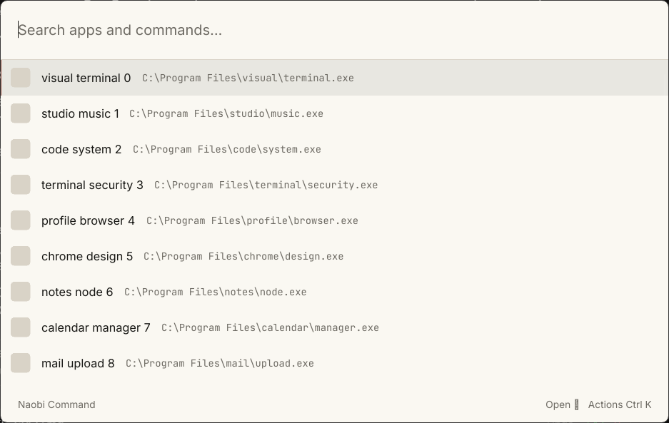
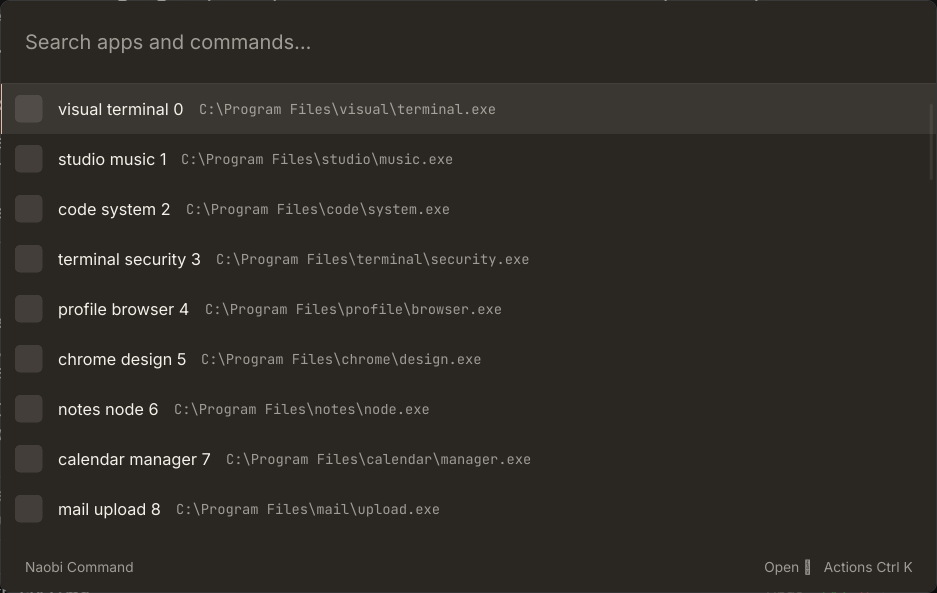
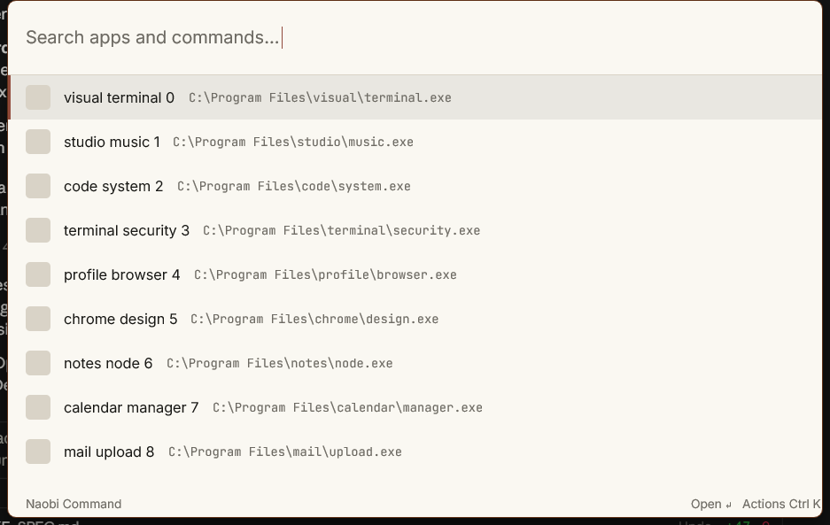
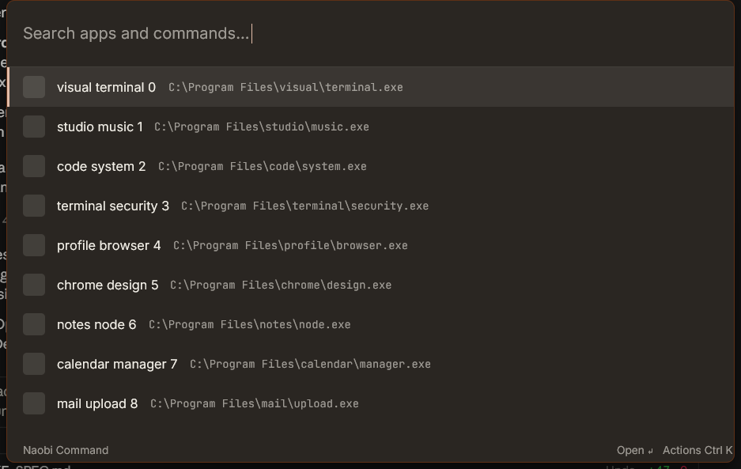

# UI prototype measurement: Slint vs GPUI (input to ledger D-002)

Status: measured 2026-10-22 by @tester (NCMD-1). Budgets are ledger R-006; accessibility/theming is R-007.
The recommendation at the end is advisory. The owner decides D-002.
Raw data: `.ai-workspace/20261021-2301-naobi-command-discover/logs/` (bench-*.json, footprint-*.json, startup*.csv, uia-*.txt).

## Method and caveats

- Spikes unmodified: `spikes/slint-launcher` (Slint 1.18.1, femtovg) and `spikes/gpui-launcher` (gpui 0.2.2, DirectX 11). Release exes, same hotkey override (`SPIKE_HOTKEY_VK=120` = Ctrl+Alt+F9, because Ctrl+Alt+Space is owned by another app on this machine).
- Machine: i7-10750H, Windows 11, active display 143 Hz (one vsync = ~7.0 ms), 125% DPI. **Not idle**: other apps (Claude desktop, Discord, Spotify, OEM services) kept total CPU at 25-33% during idle runs. Nothing was compiling during bench/footprint runs. Treat CPU numbers as upper bounds.
- Benches: 3 runs of `--bench` per framework, interleaved (S,G,S,G,S,G) to share drift; table shows the median of the 3 per-run statistics (range in brackets). Each run = 200 samples after 10 warm-up.
- Footprint: default (hidden, resident) mode, 60 s idle, then 40 Ctrl+Alt+F9 presses sent with `keybd_event` (= 20 show/hide cycles; 40 of 40 presses toggled the DWM cloak, ended hidden), then 60 s idle again. Values from `Get-Process`; GPU from the `GPU Process Memory` perf counter (dxgi/dcomp shared memory is NOT in Working Set).
- Startup is approximate: stopwatch from `Process.Start` to a polled window state (1-2 ms poll), 7 runs each, median. No tray in either spike, so "tray-ready" is proxied by "window exists and is cloaked" (the spike's last setup step).

## Where each timer stops (important)

| | Slint | GPUI |
|---|---|---|
| Native stop point | `AfterRendering` notifier: end of render, before buffer swap (understates true present slightly) | start of the frame AFTER the first frame containing the change (second `on_next_frame`); vsync-quantised, adds up to one frame interval |
| Extra variant in JSON | none | `*_frame_start_ms`: start of the first frame, before draw (lower bound) |

Median of (native - frame_start) for GPUI is 7.1 ms = 1 / 143 Hz, i.e. GPUI's native number carries about one vsync period. GPUI's like-for-like "render complete" value lies between its lower bound and its native number; Slint's number lies in that same window conceptually, but Slint gives no decomposition. So no exact like-for-like figure exists without editing the spikes; the bracket is the honest comparison.

## R-006 results

### Latency (ms, median of 3 runs; [min..max] across runs)

| Metric | Budget | Slint | GPUI native | GPUI lower bound (frame start) |
|---|---|---|---|---|
| hotkey to visible p50 | n/a | 8.69 [8.47..8.85] | 10.79 [10.77..10.84] | 3.71 [3.66..4.14] |
| hotkey to visible p95 | <= 50 | **10.75** [10.50..10.78] PASS | **14.11** [14.10..14.47] PASS | 7.39 [7.28..7.58] |
| hotkey to visible max | n/a | 11.75 [11.08..12.26] | 15.39 [15.01..16.15] | 8.32 [7.98..8.44] |
| keystroke to results p50 | n/a | 7.72 [7.71..7.76] | 11.53 [11.46..11.63] | 3.56 [3.40..3.56] |
| keystroke to results p95 | <= 16 | **10.16** [10.04..10.21] PASS | **14.22** [14.21..14.30] PASS | 6.16 [6.13..6.45] |
| keystroke to results max | n/a | 11.38 [11.21..11.51] | 15.28 [15.11..15.41] | 7.00 [6.82..7.22] |

Side by side at the comparable-ish points: Slint (end of render) 10.75 / 10.16 ms p95 vs GPUI lower bound 7.39 / 6.16 and native 14.11 / 14.22. Both pass at 143 Hz. GPUI nucleo search itself: p50 0.56, p95 1.68 ms (the search is not the bottleneck). Results exclude OS input delivery (programmatic show/query) in both.

Risk: the GPUI native number scales with the refresh interval. On a 60 Hz panel one vsync is 16.7 ms, so the same method would give roughly p95 = lower bound + 16.7 = ~23 ms (extrapolation, not measured), above the 16 ms budget even though real latency would be much lower. Slint's stop point is not vsync-bound. If the owner's budget is judged with GPUI's method, test on 60 Hz hardware.

### Footprint (hidden, resident; 60 s idle before / after 20 show-hide cycles)

| Metric | Budget | Slint | GPUI |
|---|---|---|---|
| Working Set before | <= 40 MB | 83.9 MB FAIL | 77.8 MB FAIL |
| Working Set after cycles | <= 40 MB | 108.2 MB FAIL (+24 MB) | 78.1 MB FAIL (+0.3) |
| Private Bytes before / after | info | 103.2 / 121.6 MB | 103.5 / 105.5 MB |
| Threads before / after | info | 18 / 16 | 34 / 31 |
| Handles before / after | info | 460 / 545 | 575 / 572 |
| GPU mem before (dedicated / shared) | info | 24.7 / 11.0 MB | 15.2 / 29.0 MB |
| GPU mem after (dedicated / shared) | info | 32.7 / 28.0 MB | 15.2 / 28.5 MB |
| Idle CPU, % of one core, before / after cycles | < 0.5 | 1.09 / 1.70 FAIL | 4.85 / 2.76 FAIL |
| Same, % of total CPU (/12 logical) | < 0.5 | 0.09 / 0.14 | 0.40 / 0.23 |

Notes:
- The budget's CPU unit is ambiguous. On the strict one-core reading both fail; on the whole-system reading both pass narrowly (but the machine was not idle).
- Slint's idle CPU is a spike artifact: `main.rs` leaves a second repeating 5 ms `Timer` (`done`) running forever. In a scratch copy (not the spike) with only that timer removed, idle CPU was 0.11% of one core, WS 85.7 MB, so Slint can meet the CPU budget. See `footprint-slint-variant.txt`.
- GPUI's higher idle CPU (cloaked window) was not diagnosed. It may come from continuous vsync-driven frames while cloaked; unverified.
- Working Set is dominated by cold pages: `EmptyWorkingSet` on the hidden process dropped WS to 0.6 MB (Slint) and 0.9 MB (GPUI) and it stayed there for 20 s. A trim-on-hide could meet 40 MB in either framework; the cost is page faults on the next show (not measured, would add to hotkey latency). Neither framework gets under 40 MB untrimmed. Private Bytes (~103 MB) is unaffected by that trick.

### Size, build, startup

| Metric | Budget | Slint | GPUI |
|---|---|---|---|
| Release exe | <= 20 MB | 10,795,520 B (10.3 MiB) PASS | 5,530,112 B (5.3 MiB) PASS |
| Clean release build (coders) | info | 5m32s contended, ~3m25s uncontended | 8m07s partly contended; 1.7 GiB target dir |
| Clean build, tester (Slint scratch copy, own target dir) | info | 4m09s | not re-run |
| Process start to first visible window | info | 47 ms [46..49] (window parked at -32000) | 1030 ms [927..1062] |
| Process start to window cloaked (proxy for tray-ready) | <= 300 ms | 980 ms [893..1015] FAIL | 1061 ms [959..1093] FAIL |

Both fail the cold-start budget as built (no tray, no lazy init, 10k items generated at start). Slint's window is created almost at once but its setup runs from a 5 ms timer only after the event loop reaches it (about 0.9 s later; cause not isolated). Windows start approximates real cold start only when the file cache is warm (first run of each was within range).

## Screenshots (`--show`, window rect captured at 125% DPI, 937x593 px)

| | paper | stone |
|---|---|---|
| Slint |  |  |
| GPUI |  |  |

Visual fidelity (pixel-sampled and eyeballed):
- Tokens: both reproduce the exact hex values (paper bg #faf8f2, stone bg #2a2622, line #d9d3c7, accent bar #914a3b / #e3bda9, selected wash). Inter and JetBrains Mono render in both; 1 px hairline under the header in both.
- Slint: fills the window edge to edge. Footer glyph U+21B5 shows a missing-glyph box (embedded Inter subset lacks it, no fallback). The std-widgets ListView draws a fluent-style scrollbar (visible in stone) that is not a Naobi style; replacing it means a custom list. No caret was visible in the stone capture (blink phase or caret colour; not investigated).
- GPUI: glyph fallback works (renders the return arrow), caret visible. The painted card is inset about 8-9 px on left/right/bottom inside the window rect, so desktop content shows around it and the card is smaller than the specified 750x475; a 1 px accent-coloured outline surrounds it. Likely a non-client/transparent-margin issue in the spike's window setup; not investigated. Selected row accent bar is 2 px and correct.
- Neither fidelity gap is inherent to the framework as far as measured; the GPUI inset is the bigger visible defect, the Slint scrollbar the bigger styling constraint.

## R-007 accessibility (UI Automation, depth 4, paper, `--show`)

| Build | Search box | Result rows |
|---|---|---|
| Slint spike as built (`default-features = false`, no `accessibility` feature) | not exposed: tree is a single Window `NaobiSlintSpike`, 0 children | not exposed |
| GPUI 0.2.2 spike | not exposed: single Window, class `Zed::Window`, empty name, 0 children | not exposed |
| Slint scratch variant with `accessibility` feature added (tester build, not a spike edit) | **Edit**, keyboard-focusable, Value pattern present but empty value and no Name | List with 20 children, but each row is two **Text** elements (title, path), **not ListItem**; selected state not exposed |

Findings: out of the box neither spike exposes a usable tree. Slint reaches a partial tree by turning on one default Cargo feature (verified), and could be completed with `accessible-role` / `accessible-label` annotations on the input and rows (not tested). GPUI 0.2.2 has no AccessKit in its dependency lock and no UIA provider in this tree; I did not find an upstream switch (from the lockfile only; not verified against upstream docs). Screen-reader access would be real work in GPUI. The explicit R-007 acceptance items (theme switching, contrast, keyboard-only) were not part of this measurement, except that both honour `--theme`.

## Text input capability (from spike code and coder reports; not exercised here)

- Slint: spike uses the `TextInput` primitive (single-line, `text <=> query`, `edited` callback). The runtime provides caret movement, selection, clipboard shortcuts and platform IME on the winit backend out of the box; `LineEdit` in std-widgets wraps it. Not tested here beyond typing/Esc/arrow keys (coder verified).
- GPUI: spike input is a minimal custom one (key-down appends/backspaces, static caret): no caret movement, selection, paste or IME (coder-gpui.md). A production input needs gpui's `EntityInputHandler` example or the third-party `gpui-component` crate, which I did not build or measure. Extra dependency and pinning risk.

## Risks

- Both exceed the 40 MB Working Set budget and the 300 ms cold-start budget as built; neither framework decides those, mitigations (trim on hide, lazy init, tray before UI) apply to both.
- GPUI: pre-1.0 crates.io 0.2.2 pinned to `windows` 0.61, 1.7 GiB build tree, 8 min clean build, no a11y, custom input work, vsync-bound latency metric, unexplained idle CPU, window created shown then cloaked (flash possible), margin defect above.
- Slint: femtovg GPU memory grows after show/hide (WS +24 MB, GPU shared +17 MB); software renderer cannot supply the frame notifier; styling beyond fluent widgets requires custom components; ~2x exe size of GPUI; glyph fallback for symbols needs a font subset fix.
- Measurement limits: busy machine, programmatic input, one 143 Hz display, no PowerToys baseline taken here (R-006 asks for it separately).

## Recommendation (advisory)

Slint is the lower-risk choice for D-002 on this evidence. Both frameworks pass the two latency budgets at 143 Hz, so latency does not separate them (GPUI's margin is thinner and refresh-rate dependent). Slint separates on: lower and more stable p95 (10.8 / 10.2 vs 14.1 / 14.2), idle CPU 0.11% once the spike's leftover timer is fixed, 18 vs 34 threads, a working accessibility path (Edit and List exposed with one feature flag, verified), a production text input already in the runtime, and a stable release train. GPUI's advantages are a 2x smaller exe, a more complete visual feel (glyph fallback, no foreign scrollbar) and fewer GPU resources, but it needs custom or third-party work for text input and accessibility and has the higher idle CPU and build cost. Revisit if the owner weights binary size or GPUI-level custom rendering above accessibility and input maturity; and plan trim-on-hide and lazy init either way to hit R-006.
